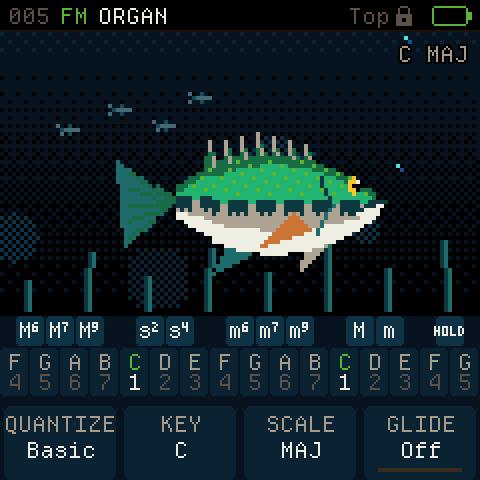
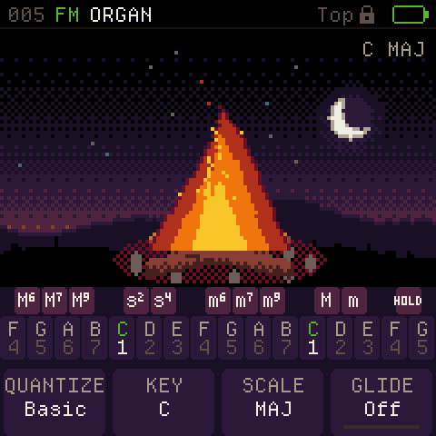
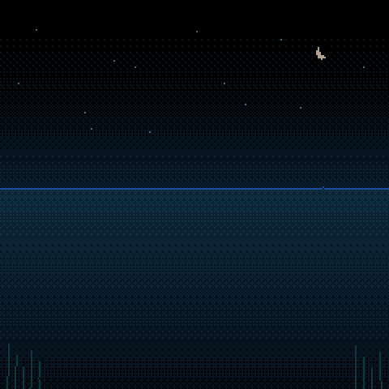

# Chase FM-1

Chase's personal firmware for the **M-VAVE FM-1**, built on [CoralFlower](https://github.com/FicusFicusov/CoralFlower).

**New UI implementation handoff:** [Start here](docs/design/chord-first/AGENT-START.md) · [Full plan](docs/design/chord-first/IMPLEMENTATION-PLAN.md) · [Instrument Teal prototype](docs/design/chord-first/instrument-teal/prototype.html) · [Player guide](docs/CHORD-FIRST-USER-GUIDE.md).
Instrument Teal is the planned default; Motion is On (adaptive) / Off. These are implementation references, not behavior in the release below.

**Release 0.6-chase7** adds a 100-idea HOME progression explorer, contextual variations with undo,
and live FX preset auditioning. Auto Harmony, refreshed drum grooves, Bass/Bonfire visuals, Diagnostics
and six-channel USB recording remain included.

**[Download the firmware (.fwsc)](https://github.com/chasedeanda/chaseflower-fm1/releases/download/v0.6-chase7/coralflower-0.6-chase7.fwsc)** ·
[Release notes](docs/releases/0.6-chase7.md) · [All releases](https://github.com/chasedeanda/chaseflower-fm1/releases)

<p align="center"></p>

<table>
  <tr>
    <td align="center"><br>Bonfire</td>
    <td align="center"><br>Chase FM-1 startup</td>
  </tr>
</table>

These animations come from the firmware renderer. The boot preview holds its last frame for viewing; the
instrument's intro runs for 2.4 seconds and any input skips it.

## Play and explore

- **Top Lock, always.** Upper keys choose a chord type; lower keys play roots. The chosen chord stays latched until
  you select another one. Your saved Top chord-button definitions are retained.
- **Progressions, Bass, Bonfire, or Nothing.** Turn **ALGORITHM** on HOME to change the main screen without interrupting a held chord or playback.
  Progressions is the new default; Progressions and Nothing skip scene animation. Your choice is saved. ALGORITHM still orders effects in FX and selects patterns/songs
  in Sequencer.
- **Four HOME views.** Tap HOME while already there to cycle **Scene → Chord → Keyboard → Diagnostics**. From
  another screen, HOME returns to your selected view.
- **Chords, bass, arpeggios and grooves.** Choose from 27 scales, chord extensions and inversions, a separate bass
  voice, nine arpeggiator patterns, eight sequencer patterns and a song arrangement. Three additional grooves use 6/8.
- **Ambient and lo-fi banks.** The chase3 library adds 96 chord/layer sounds, 24 bass sounds and eight drum kits in
  eight style banks, including 32 CC0 Aquanode voices. Existing saved sound positions and user sounds are preserved.
- **Six effects.** Filter, drive, chorus, phaser, delay and reverb, in the order you choose.
- **USB audio and MIDI.** Record six-channel USB capture at 44.1 or 48 kHz while USB MIDI remains available.
  See the [GarageBand and Spark setup](docs/USB-AUDIO.md).
- **Diagnostics.** Monitor audio workload, UI cadence, linked memory and USB status. Configure the dashboard from
  **GLO → Diagnostics**. [Read the measurements guide](docs/DIAGNOSTICS.md) before interpreting timing numbers.

[Scenes and controls](docs/VISUALS.md) · [Sound banks and 6/8](docs/CHASE3.md) ·
[Diagnostics](docs/DIAGNOSTICS.md) · [USB recording](docs/USB-AUDIO.md)

**Progression explorer:** HOME starts with [130 browsable ideas](docs/PROGRESSION-EXPLORER.md),
including [30 selected song snippets](docs/research/SPOTIFY-COVER-SHORTLIST.md) in the development source,
including [eight Morgan Wallen sections](docs/research/MORGAN-WALLEN-COVER-SNIPPETS.md).
Turn SELECT to explore; key, scale and meter follow the idea. K1 changes rhythm, and matching chord cards light
while you play. ALGORITHM cycles Progressions, Bass, Bonfire and Nothing.

**Auto Harmony:** Open **GLO → Harmony** and turn **K1 On** for
[major/minor chords and button-selected extensions](docs/AUTO-HARMONY.md). Off leaves normal playing alone.

[Refreshed drum grooves and audio auditions](docs/DRUM-LOOPS.md): 39 two-bar patterns spanning lo-fi, trap, gaze,
hip-hop, house, garage and breaks, including 12 refreshed additions and a 3/4 Waltz. Included in this release.

[Four small sound additions](docs/MELODEE-DRUMS.md) are available in development source: **AQ33 DX SAX** and
**AQ34 FULLFLU** chord sounds, plus **M Retro** and **M FM** drum kits. They reuse the existing engines,
bringing the library to 190 named melodic presets and 24 kits.

**FX presets:** [Browse 40 factory chains](docs/FX-PRESETS.md) across Signature, Space, Lo-fi, Motion and Punch,
plus 16 optional user slots. SELECT auditions immediately, K2 clears to dry, and K3 restores the previous chain.

**Variations:** Open **GLO → Variation**, choose a context and amount,
turn **K3** to generate, and **K4** to undo. [Controls and scope](docs/PHASE4-PLAN.md).

**Development source:** The chord-first build opens directly to Progressions and omits Bass/Bonfire scenes
and the fish startup animation. [Scene removal and measured resources](docs/SCENE-FREE.md).
[Three recent recordings, newest first](docs/RECORDINGS.md) replace the eight-slot recorder and recorder Undo.
[Measured recording RAM savings](docs/PATTERN-MEMORY.md). The published download above remains the released build.

The development build now has native Instrument Teal HOME banks and a shared-clock
**SEQ → Groove / Loop / Mix / Click** workspace (ALGORITHM changes tab). Loop
supports the full phrase with Repeat On/Off; Click can sound alongside a groove.
**GLO → Legacy tools → K1 → SEL** opens Recordings, Metronome or Drum grid.
[Native captures and implementation checks](docs/design/chord-first/native-accompaniment/README.md)
are host evidence; physical verification remains pending.

**EDIT** from the development Progressions/Accompaniment workspace now opens a
protected sixteen-slot semantic draft: chord, timing, voicing, bass, phrase and
undo controls share the existing player. Quiet checkpoints recover after reboot
and support backups; numbered Songs and chord-library/audition are still pending.
[Native editor controls, captures and evidence](docs/design/chord-first/native-editor/README.md).

## Install this release

1. Download **`coralflower-0.6-chase7.fwsc`** from the [GitHub release](https://github.com/chasedeanda/chaseflower-fm1/releases/tag/v0.6-chase7).
   This is the installable file; the separate app `.bin` and GitHub source archives are not installer packages.
2. Save a current backup of your sounds, settings and patterns. The installer can back up compatible CoralFlower,
   ChoralRoot and Felucca data. Keep the backup somewhere safe.
3. Open the [upstream installer's custom-build section](https://ficusficusov.github.io/CoralFlower/#own) in Chrome
   or Edge on a computer. Connect the FM-1 directly with a data-capable USB cable.
4. Expand **Another version, or a build of your own**, click **Choose a .fwsc file**, and select your download.
   Check that **`coralflower-0.6-chase7.fwsc`** is selected before pressing Install. The installer's default is
   upstream CoralFlower, so select this custom file first.
5. Install from that custom-build section and keep the cable connected and page open until the restart.
6. Confirm the **Chase FM-1** bass-jump startup and **`CoralFlower 0.6-chase7`** in INFO. The INFO family, package
   identity `FM-1_930` and USB names remain compatible with the existing installer and recording setup.

The release includes checksums and licence files. See [release notes](docs/releases/0.6-chase7.md) for validation
and recovery details. Host and firmware-build checks pass; the combined release's hardware appearance and timing
still need to be checked on the FM-1.

**Songs library (development preview):** SAVE from Progressions, accompaniment or the editor opens [Songs](docs/SONGS-LIBRARY.md). Save and recall six editable ideas with their musical setup; rename, duplicate or delete them, and open existing recordings from the same list. Full recording-library management and physical-device validation remain pending.

## Build and verify

Generate headers with Python 3, Pillow 11.1.0 and fontTools 4.66.1, then run the feature checks:

```sh
python3 tools/build.py --gen-only
sh tools/test_fx_presets.sh
sh tools/test_progressions.sh
sh tools/test_variations.sh
sh tools/test_drum_bank.sh
sh tools/test_auto.sh
sh tools/test_visuals.sh
sh tools/test_diagnostics.sh
sh tools/test_chase3.sh
sh tools/test_usb.sh
```

Build with the JieLi Linux x86-64 toolchain (Docker on Apple Silicon):

```sh
./build.sh --release 0.6-chase7
```

See [Mac build setup](docs/CHASEFLOWER.md#build-on-an-apple-silicon-mac) for the toolchain and Python environment.
A fresh checkout generates fonts, icons, tables and samples into `build/gen/`. GitHub Actions runs the complete
host checks; the release workflow builds firmware from its tagged source revision.

The inherited [CoralFlower browser demo](https://ficusficusov.github.io/CoralFlower/play/) runs upstream firmware;
it does not include all Chase FM-1 changes.

## Credits and licence

CoralFlower is a fork of [ChoralRoot FM-1](https://github.com/Quixotic7/ChoralRootFM1) by Quixotic7, which is itself
a fork of [Felucca](https://github.com/hugelton/Felucca) by Leo Kuroshita (Hügelton Instruments). The FM engine comes
from [Melodee](https://github.com/keremimo/melodee) by Kerem Kilic, and the screens use
[Departure Mono](https://departuremono.com), a font by Helena Zhang. Thank you all.

CoralFlower is free software under the GPL-3.0. `LICENSE` and `LICENSING.md` have the details.

M-VAVE and FM-1 are trademarks of their respective owners. Orchid is a product of Telepathic Instruments. CoralFlower
is not affiliated with M-VAVE, Cuvave or Telepathic Instruments.

## Feedback

Track Chase FM-1 changes in [this repository's issues](https://github.com/chasedeanda/chaseflower-fm1/issues).
Earlier ChaseFlower notes and plans remain in `docs/` as historical records.
