# CORD · FM-1

**CORD 1.0.3** · [Install the latest release](https://chasedeanda.github.io/cord-fm1/install/) · [1.0.3 release notes](docs/releases/1.0.3.md)

**A chord instrument, groovebox and songwriting companion for the M-VAVE FM-1.**

Start with a progression, choose a sound and press PLAY. Add drums, shape the bass, turn a chord into an arpeggio, or take over with your own playing. CORD puts the controls you reach for on the HOME screen, with a live chord display and a little Devil or Cat keeping you company.

**[▶ Play in your browser](https://chasedeanda.github.io/cord-fm1/play/)** · **[Download firmware](https://github.com/chasedeanda/cord-fm1/releases)** · **[Install now](https://chasedeanda.github.io/cord-fm1/install/)** · **[Quick start](#make-your-first-loop)**

<p align="center">
  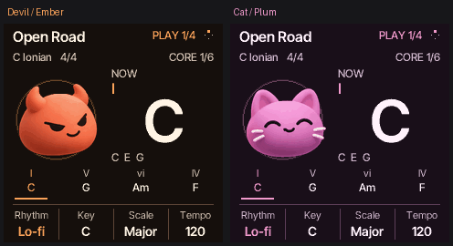
</p>

This guide documents **current `main`**, including the nine HOME pages, Variations, visual ARP, FX presets and Songs. A downloaded release contains the features listed in its own release notes; the browser player shows its exact source revision in the footer. The newest published hardware package is available on the [releases page](https://github.com/chasedeanda/cord-fm1/releases).

Screenshots are captures of the real 240 × 240 firmware renderer. Playback GIFs show the engine running in the computer emulator. They illustrate the interface; browser speed does not measure the physical FM-1's CPU headroom.

## What you can do

| Start with… | Then make it yours |
| --- | --- |
| **130 progression ideas** | Browse genres and modes, transpose, change the groove, or edit up to sixteen chord slots. |
| **Chord and bass sounds** | Explore eight ambient/lo-fi banks, shape envelopes and synth parameters, and save your own patches. |
| **Drums and a shared clock** | Pick a kit, add swing, play a one-bar fill, drop the drums and bring them back on the downbeat. |
| **Thirteen arpeggiator modes** | Follow the piano roll; change octaves, rate, gate, swing, latch or strum spacing. |
| **Thirteen FX presets** | Load a sound with SEL, then shape Space, Echo, Motion and Warmth. |
| **Contextual Variations** | Explore Harmony, Arp, Drums, FX, Sound or Scale, with a previous-result control. |
| **Chord Lab and the keyboard guide** | See the notes, degrees and intervals; audition a comparison or a possible next chord. |
| **Songs and recordings** | Save six complete editable ideas, keep your latest three manual takes, or capture stereo audio and stems over USB. |

## Find your way

[First loop](#make-your-first-loop) · [Browser player](#play-without-an-fm-1) · [Controls](#the-controls) · [HOME pages](#nine-home-pages) · [Keys & Harmony](#play-chords-and-learn-the-keys) · [Progressions](#explore-progressions) · [Drums](#drums-loops-and-live-performance) · [Sounds](#choose-and-shape-your-sounds) · [ARP](#arpeggios-and-strums) · [Effects](#effects) · [Variations](#variations) · [Editor](#write-your-own-phrase) · [Chord Lab](#chord-lab) · [Songs](#save-and-recall-ideas) · [Recording](#record-your-playing) · [USB & MIDI](#connect-to-your-computer) · [Display & settings](#make-it-yours) · [Help](#when-something-isnt-working) · [Build](#build-the-firmware)

## Make your first loop

1. **Choose an idea.** On HOME → **Core**, turn **SELECT**. The idea supplies a starting key, scale and metre. Bring MASTER up gently.
2. **Add a beat.** Turn **K1 Rhythm** to a named groove. **K4 Tempo** sets the pace. Press **PLAY** to hear the progression and drums; press it again to stop.
3. **Pick your sounds.** Turn **ALGORITHM** one page to **Sound**. K1 chooses the chord sound, K2 the bass sound; K3/K4 balance them.
4. **Add some space.** Press **FX**, browse a preset with SELECT and press **SEL** to load it. Try Velvet, Slap or Deep Space. HOME returns to Core.
5. **Play over it.** The lower keys play roots; the upper keys choose chord types and colors. Live playing takes over the harmony while the groove and phrase cursor keep moving. Release your roots and HOLD to return to the scheduled progression.
6. **Keep the idea.** Press **SAVE**, select **+ Save current idea**, then press **SEL**. Stop playback, release held notes and let the tails fade. Wait for **Saved** before powering off.

For **drums with your own chords**, set **HOME → Loop → K1 Mode → Drums only**, return to Core and press PLAY. No trip into the sequencer is needed.

## Play without an FM-1

**[Open the CORD browser instrument](https://chasedeanda.github.io/cord-fm1/play/)** and press **Start** for sound. It runs the firmware compiled to WebAssembly, with the screen, panel, knobs and key LEDs. Settings and saved sounds stay in that browser.

Click or tap the panel, drag or scroll knobs, or use these computer keys:

| Computer control | FM-1 control |
| --- | --- |
| **Q W E R T Y U I O** | Roots G3 A3 B3 **C4** D4 E4 F4 G4 A4; **R = C4** |
| **A / P / Z X C V B** | F3 / B4 / C5 D5 E5 F5 G5 |
| **1–0 / backtick (`)** | Upper chord modifiers, left to right / HOLD |
| **Space / Enter** | PLAY / REC |
| **Home** | HOME |
| **F1 / F2 / F3 / F4 / F5 / F6** | FX / SEL / ENV / LFO / EDIT / GLO |
| **F8 / F9 / F10** | SAVE / ARP / SEQ |
| **[ / ]** | PRESETS down / up |
| **; / '** | SELECT down / up |
| **, / .** | ALGORITHM down / up |
| **Tab, then arrow keys** | Select a knob, then turn it |
| **− / =** | OCT− / OCT+ |
| **Esc** | Leave panel keyboard focus |

Right-click a panel key/button to hold it. **Enable MIDI** offers optional MIDI input/output in supporting browsers. The player is a way to try the instrument; installing firmware is a separate action.

The **PLAY** button is green while the transport runs and orange when stopped. Orange blinks while waiting for external clock or after clock loss. **REC** stays red while recording and blinks red during count-in. The browser shows the same transport colors.

## The controls

**K1–K4 are the four knobs labelled along the bottom of each screen.** Read that footer whenever you change pages. SELECT browses; SEL is the button that opens or confirms an item.

| Control | What it does |
| --- | --- |
| **HOME** | From another workspace, return to Core. Already on HOME? Advance to the next HOME toolbar. |
| **ALGORITHM** | Cycle HOME toolbars in either direction; elsewhere, change the workspace's tabs. |
| **SELECT** | Browse progression ideas on any HOME page; elsewhere, select an item, slot or settings page. |
| **PRESETS** | Change the chord sound from HOME. |
| **PLAY** | Start/stop accompaniment; in the recording workspace, replay the selected take. |
| **REC** | Start a manual take with a count-in; press again to finish, hold to cancel the new take. |
| **SEQ** | Accompaniment: Groove, Loop, Mix and Click. |
| **EDIT** | From HOME, accompaniment or Lab, open the protected phrase draft. Sound pages retain their sound-editing route. |
| **SEL** | On HOME, open Chord Lab; elsewhere, execute the displayed action. |
| **SAVE** | Open Songs from the musical workspaces. Sound, FX, recording and Variations pages have their own labelled save actions. |
| **ENV / LFO / ARP / FX** | Envelope / linked bass / arpeggiator / effects. |
| **GLO** | Display, MIDI, playing preferences, sound library and other system pages. |
| **MASTER / OCT− / OCT+** | Output volume / playing register. |

Changing screens leaves playback running. A selected row, edit focus or chord name is not an audition: use the displayed PLAY or SEL action to hear it.

### Sounds in CORD Studio

In **Studio → Genre**, use **K1** to browse genres or **K2** to jump between Guitar, Electronic and Experimental. In **Sound → Sound Library**, use **K1** to choose **Genre** or **All sounds**. The Genre view shows the current palette and how many presets or kits each part has. **SEL Apply** loads the genre's featured set.

On the **Sound** overview, **EDIT** rerolls the band's presets and drum kit. Zoom into a part's **Tone** page to reroll that part only, or turn **K1** to browse its presets in order. Edit shuffles each part's choices without repeating until that part's palette has been heard.

Each genre also has an original Chords, Bass and Layer trio. The listening pack compares each voice and each full band against the genre's featured set. [CORD Studio Originals](docs/CORD-STUDIO-ORIGINALS.md)

Rerolling keeps the effects chain and the part's drive, chorus, delay and reverb sends. For effects, open **FX Presets**, browse with **K1**, and use **SEL** to recall one or **EDIT** to edit the loaded effect.

### GLO Live in CORD Studio

Press **GLO** to open the live keyboard controls. Press **GLO** or **HOME** to return to the previous page, or press **SAVE** from GLO for Settings. Turn **ALGORITHM** for **Map** or **State**, and turn **SELECT** for tempo.

In **Sound**, turn **ALGORITHM** to select the **Mix** panel and press **SEL** to open it. K1–K4 set the Chords, Bass, Drums and Layer levels.

| Keys in the live mixer | Action |
| --- | --- |
| First four black keys | Toggle mute for Chords, Bass, Drums and Layer |
| First four white keys | Solo those parts while held |
| Black keys 7–10 | Toggle kick, snare, hats and percussion |
| C4 / D4 | Pause or resume / restart the Studio groove |
| E4 / F4 | Unmute all / tap tempo |
| G4 / A4 | Fill while held / queue a one-bar fill |
| B4 | Drop or bring back drums at the next bar |

With MIDI clock input, pause, restart and tempo follow the external clock. The keyboard-map layout follows [JIANT FM’s GLO layer](https://juanjiant-bit.github.io/JIANT/manual/shots/layer_glo_active.png).

## Nine HOME pages

Turn **ALGORITHM** either way, or tap **HOME**, to move through this order. **Harmony / Keyboard is always last**, immediately before Core. SELECT continues browsing progression ideas on every HOME page.

| Page | K1 | K2 | K3 | K4 |
| --- | --- | --- | --- | --- |
| **1 · Core** | Rhythm | Key | Scale | Tempo |
| **2 · Sound** | Chord sound | Bass sound | Chord level | Bass level |
| **3 · Texture** | Reverb mix | Delay mix | Chorus mix | Glide |
| **4 · Groove** | Kit | Drum level | Swing | Click level / Off |
| **5 · Perform** | Fill | Drop drums | Bring back | Tempo |
| **6 · Loop** | Chords + Drums / Drums only | First slot, read-only | Last slot, read-only | Repeat On/Off |
| **7 · Mix** | Chord level | Bass level | Drum level | Bass link On/Off |
| **8 · Variations** | Context | Amount | Generate, turn right | Undo / Cancel, turn right |
| **9 · Keyboard / Harmony** | Harmony On/Off | Reset Harmony defaults | — | — |

<p align="center">
  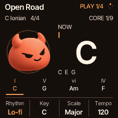
  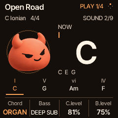
  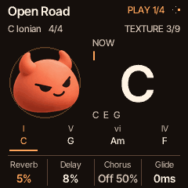
</p>
<p align="center">
  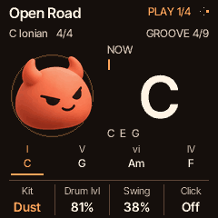
  
  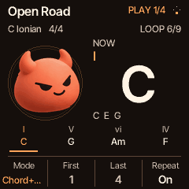
</p>
<p align="center">
  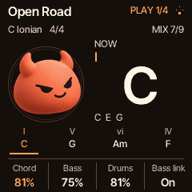
  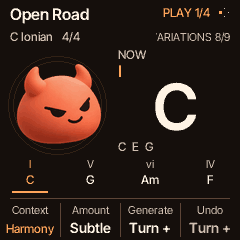
  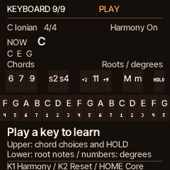
</p>

**Read the main display:** the large chord and note names describe the sounding harmony. The phrase rail is the plan; its underline and slot counter show the actual sequence position. Matching cards can highlight together when the same chord appears more than once. **Next** and **Queued** describe a future change, not the current sound.

**Texture says Off or Byp?** Its knobs adjust the effect mix; enable that effect in FX or load a preset first. **Loop and Mix** share the same settings as their SEQ tabs. **Repeat Off** plays the complete phrase once.

## Play chords and learn the keys

Lower keys choose roots. Upper keys select qualities, extensions, suspensions and **HOLD**. With the default **Top Lock** layout, tap a modifier to latch it and tap again to clear it. A new modifier gesture replaces the previous selection; hold compatible buttons together to combine them. HOLD sustains your live chord after the root is released.

### Auto Harmony

**Auto Harmony is On by default for fresh settings.** An existing saved On/Off choice is preserved. On **HOME → Keyboard**, **K1 Harmony** changes it. Choose a key and seven-note scale in Core; each root produces a major or minor chord. Upper keys add the colors you choose. This is also available under **GLO → Harmony**.

For example, in **E major**, selecting **7** and playing **E → B → D♯** gives **Emaj7 → Bmaj7 → D♯m7**. Auto uses its own major/minor rule with normal fifths; it does not automatically make every scale's seventh-degree chord diminished. Explicit source-song chords retain their written qualities.

| Modifier | Listen for |
| --- | --- |
| **Major / Minor** | Choose the quality explicitly. |
| **6 / 7** | Add a sixth; or a major seventh on a major chord and minor seventh on a minor chord. |
| **9 / Add9** | 9 includes the seventh; Add9 adds the ninth without it. |
| **Sus2 / Sus4** | Replace the third with a second or fourth. |
| **Add2 / 11** | Keep the third and add color; 11 includes the seventh and ninth. |
| **HOLD** | Sustain roots independently of modifier selection. |

**K2 Reset** restores Harmony's factory assignments and turns Harmony On. To customize upper-key assignments, open **GLO → Harmony → SEL**; K1 selects the modifier, K3 its inversion and K4 its bass tone. HOLD is not an editable modifier.

### The keyboard guide and root lights

The last HOME page shows all **27 physical keys**, current root names, scale degrees and modifier assignments. Play a key to hear it and read an explanation. The guide follows the current key, scale, octave and Harmony settings.

The progression guide uses **root LEDs** for sounding and upcoming chords, keeping the flashing next root distinct from a steady playing root. In Drums only mode, the steady cue follows the planned current root until you play a live root; the next-root blink follows the shared phrase clock. The same guide works in the SEQ accompaniment workspace. Upper-key lights still reflect modifier choices, including Major/Minor. The guide avoids lighting every chord tone as a competing next-note cue. Manual playing and unsupported-scale fallback retain their applicable lighting behavior.

**AUTO?** means Harmony cannot resolve the current setup: use Quantize Basic/Full and a seven-note scale. MIDI Direct plays incoming notes directly. [Harmony details](docs/AUTO-HARMONY.md) · [Keyboard guide](docs/KEYBOARD-LEARN.md)

## Explore progressions

Turn **SELECT** on HOME to browse **130 ideas** spanning pop punk, songwriter, emo, math rock, jazz/soul, ambient, cinematic, dance and more. Each idea includes a starting key, mode and metre. The catalogue includes **2/4, 3/4, 4/4, 5/4, 6/8 and 7/4**.

- **PLAY** starts the idea at its first slot, with linked bass when enabled and the selected compatible groove.
- **K1 Rhythm** offers Off, Click and grooves compatible with the current metre, without changing your tempo.
- **Key / Scale** changes during playback arrive at the next chord; groove and idea changes arrive at the next bar. Tempo changes preserve the current phase.
- **SELECT during playback** queues the new idea. Browse back to the active idea to cancel that pending switch.
- **Play live** to take over the harmony. Drums and the scheduled cursor continue; releasing the final live root/HOLD returns to the current scheduled chord.

For faster browsing, open **GLO → Browse**: K1 jumps ten catalogue positions, K2 jumps one, K3 chooses **Catalog / A–Z / Shuffle / Favorites**, and K4 stars the idea. SAVE there also toggles its favorite. The chosen order and favorites survive restart.

Song excerpts are chord-practice starting points; they do not reproduce a recording's arrangement, melody or exact timing. [Full catalogue and source notes](docs/PROGRESSION-EXPLORER.md)

## Drums, loops and live performance

<p align="center">
  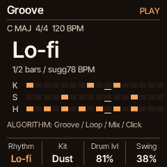
  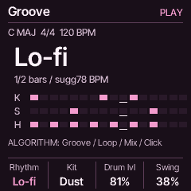
  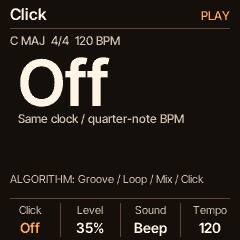
</p>

**HOME → Core** chooses the groove. **HOME → Groove** changes its kit, level and swing. Try Lo-fi, NeoSoul, TripHop, Trap, CloudTrap, Plugg, Rage, NuGaze, DreamPop, Slowcore, LoHouse, Garage, Jungle or MathRock. The bank also includes dedicated **6/8** patterns. Kit and swing changes during playback wait for the next bar.

**SEQ** opens the dedicated **Groove / Loop / Mix / Click** workspace. Its Loop and Mix controls are the same ones available directly on HOME. Click has its own On/Off, level, sound and tempo controls, so a metronome can sit alongside a groove.

### Fills, drops and returns

Start a real drum groove, then go to **HOME → Perform**:

1. Turn **K1 Fill** either way to queue a one-bar fill. The groove returns automatically after that bar.
2. Turn **K2 Drop** to take drums out at the next bar while chords and bass continue.
3. Turn **K3 Back** to restore the groove at the next downbeat, with an outward visual bloom.
4. **K4 Tempo** remains available when the internal clock owns tempo.

<p align="center">
  
</p>

**FILL NEXT / DROP NEXT / BACK NEXT** are pending actions; **FILL / DRUMS OFF** are active states. These are live performance gestures, disabled during recording. Capture the complete performance over USB audio if you want to retain the fills and drops. [Groove catalogue](docs/DRUM-LOOPS.md) · [Performance behavior](docs/DRUM-PERFORMANCE.md)

## Choose and shape your sounds

CORD includes FM and virtual-analog sounds, chord and linked bass parts, and eight style banks. **HOME → Sound** is the quickest way to choose and balance chord/bass sounds. PRESETS also changes the chord patch from HOME.

| Bank | Starting direction | Matching kit |
| --- | --- | --- |
| **Dusty Room** | Worn electric keys, muted bells and lo-fi textures | Dust |
| **Tape Garden** | Slow pads, faded strings and gentle movement | Tape |
| **Night Jazz** | Electric keys, organ and mellow plucks | Brush |
| **Soft Focus** | Warm pads, choir-like textures and swells | Air |
| **Glass Cloud** | Bright pads and bell-like tones | Glass |
| **Dub Bloom** | Dark stabs, organs, resonant tones and subs | Dub |
| **Wood & Water** | Mallets, plucks and reed-like synths | Wood |
| **Chill Circuit** | Soft electronic chords, moving pads and bass | Chill |

In **GLO → Sound library**, K1/K2/K3 filter chord/bass/layer banks; K4 returns all filters to **All**. Filtering leaves the loaded sound alone until you choose another. At power-on, chord/layer discovery defaults to Primary with Signature 8 first; Bass uses All. Saved sound selections remain.

<p align="center">
  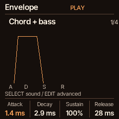
  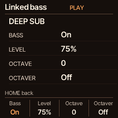
  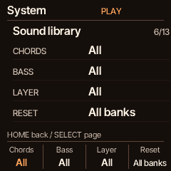
</p>

**ENV** shapes attack, decay, sustain and release for the displayed target. SELECT changes the target; **ENV → EDIT** opens advanced FM6/VA editing. **LFO** opens linked bass: On/Off, level, octave and octaver.

To keep **a sound only**, press **SAVE from ENV or the sound editor**, choose New and its name/target, then **hold SAVE for one second**. To retain the whole musical setup, save an idea in Songs instead. [Sound catalogue](docs/CHASE3-SOUNDS.md)

## Arpeggios and strums

<p align="center">
  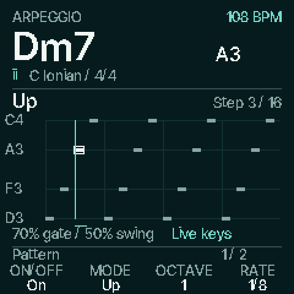
  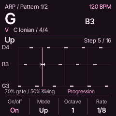
</p>

Press **ARP** to turn a chord into a note pattern. The roll shows pitch, note length, swing and the current event while keeping the full chord name visible. Global ARP works with live chords and scheduled progression chords; bass stays sustained beneath it.

| Tab | K1 | K2 | K3 | K4 |
| --- | --- | --- | --- | --- |
| **Pattern** | On/Off | Mode | Octaves 1–4 | Rate, or strum spacing |
| **Timing & hold** | Gate | Swing | Latch | Chord-sound Glide |

ALGORITHM or SELECT changes tabs. Tempo stays on **HOME → Core → K4**.

**Thirteen modes:** Up, Down, Inclusive, Exclusive, Random, Order, Repeat, Strum up, Strum down, Converge, Diverge, Low pedal and High pedal. Converge walks outside-in; Diverge walks inside-out. Pedal modes alternate an anchor note with the other chord tones.

**Latch** continues a live arp after release. **Strum** spreads the chord's attacks; Gate/Swing are unavailable there because the notes sustain. Random shows played history rather than pretending to predict future notes. [Full ARP guide](docs/ARP.md)

## Effects

<p align="center">
  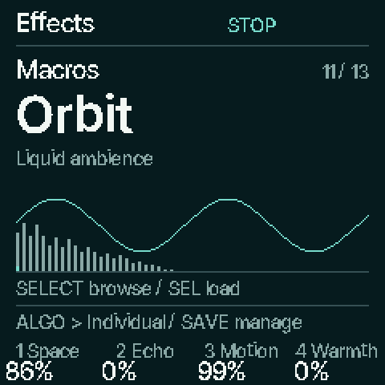
  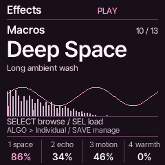
  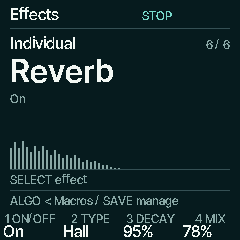
</p>

Press **FX** for Macros. **SELECT browses; SEL loads** the highlighted preset. Browsing leaves the sound alone. Shape it with **K1 Space**, **K2 Echo**, **K3 Motion** and **K4 Warmth**. ALGORITHM switches between **Macros** and **Individual**; SELECT in Individual chooses the effect.

| Preset | Character |
| --- | --- |
| **Clean** | Unprocessed starting point |
| **Velvet / Bite** | Dark and rounded / gritty and forward |
| **Slap / Ping Pong** | Short doubling / separated stereo repeats |
| **Wide Drift / Phase Sweep** | Slow chorus / pronounced phaser movement |
| **Radio** | Narrow, boxy midrange |
| **Silver Plate / Deep Space** | Bright reflections / long hall with echoes and chorus |
| **Orbit** | Sweeping phaser and chorus into a long plate, without echoes |
| **Phone LP / Phone HP** | Strongly muffled / thin and raspy handset colors |

The six effects are **Filter, Drive, Chorus, Phaser, Delay and Reverb**. SAVE in FX manages **sixteen user FX slots**; hold SAVE for one second to commit the displayed action. Sound patches, FX presets and complete Songs are separate save destinations.

The moving graphic is a response illustration, not an oscilloscope. It settles at silence; Motion Off keeps a static readout while controls still update. [FX controls and preset details](docs/FX-PRESETS.md)

<details>
<summary>See all thirteen factory FX screens</summary>

<p align="center">
  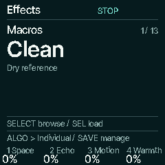
  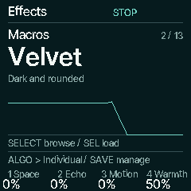
  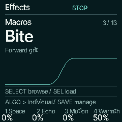
  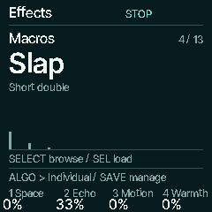
  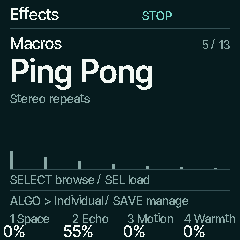
  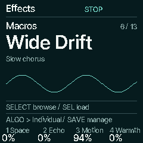
  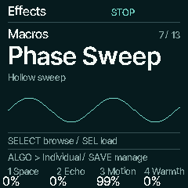
  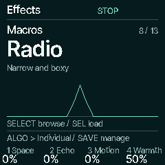
  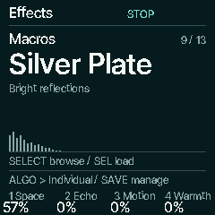
  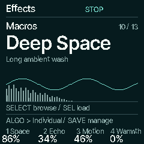
  
  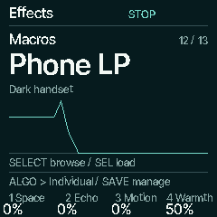
  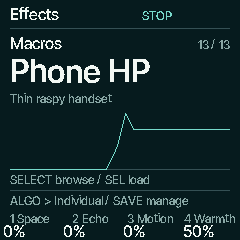
</p>

</details>

## Variations

**HOME → Variations** brings the existing variation system onto its own toolbar. The same controls remain under **GLO → Variation**.

1. Choose **K1 Context**: Harmony, Arp, Drums, FX, Sound or Scale.
2. Choose **K2 Amount**: Subtle, Musical or Chaos.
3. Turn **K3 right** to generate a result.
4. Turn **K4 right** to swap the previous/current result, or cancel a queued change.

| Context | What changes |
| --- | --- |
| **Harmony** | Explore another catalogue progression. |
| **Arp** | Gate/swing at Subtle; broader mode, range and timing changes at higher amounts. Does not turn ARP or Latch on for you. |
| **Drums** | Small swing changes, or another same-metre groove near the current tempo with its matching kit/swing. |
| **FX** | Effect parameters; higher amounts can also change enabled effects and order. |
| **Sound** | Envelope parameters on the selected sound part. |
| **Scale** | Explore another supported scale while keeping the current tonic; Auto Harmony retains compatible scales. |

Read the message after generating. Some contexts wait for playback to finish or for roots/HOLD/Latch to release; active drum changes use the next-bar handoff. **Leaving Variations or changing its context/amount cancels a waiting action.**

SAVE follows the context: FX opens FX management, Sound opens New sound saving, Harmony suggestions stay in the session, and other supported settings use their existing persistence. A queued result must apply or be cancelled first. Use Songs when you want to keep a complete idea.

## Write your own phrase

Choose an idea and press **EDIT**. The original stays intact while you work on a protected copy of up to **sixteen slots**. **SELECT** chooses the numbered slot; **ALGORITHM** changes editing tabs. PLAY hears the complete draft.

| Tab | What you edit |
| --- | --- |
| **Edit Chord** | Degree, quality, color and bar length |
| **Timing** | Bars or quarter-note units, length, gate and tie |
| **Voicing** | Inversion, including Smooth, and chord register |
| **Bass** | Bass tone, register and per-slot bass enable |
| **Phrase** | Insert, Duplicate, Remove or Undo; position and metre. Section A is currently fixed. |

<p align="center">
  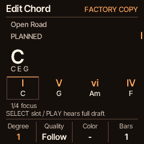
  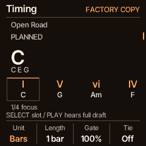
  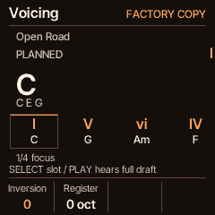
</p>
<p align="center">
  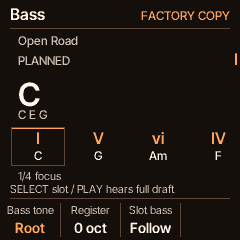
  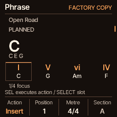
  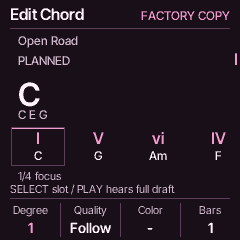
</p>

Try **Voicing → Smooth** for closer movement between chords. In Phrase, choose an action with K1 and press SEL. Remove asks for confirmation; **Phrase → Undo → SEL** reverses the last phrase change. The focus box marks the slot you edit; the underline marks what is playing.

A draft checkpoints after playback stops, roots/HOLD are released and tails fade. **RAM PENDING** is not yet saved across power-off: wait for **CHECKPOINT**. A restored working copy says **RECOVERED**. Opening another source with a dirty draft presents a choice, with Return to draft as the default. For independent named ideas, use Songs.

## Chord Lab

Press **SEL on HOME** to inspect what you hear. Turn **ALGORITHM** through four views:

<p align="center">
  
  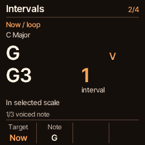
</p>
<p align="center">
  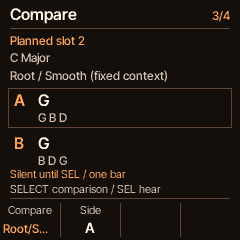
  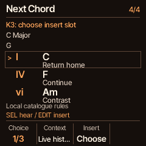
</p>

- **Notes & Degree:** inspect Now, Last or a numbered planned slot with SELECT/K1. Read the actual voiced notes and degree.
- **Intervals:** K2 focuses an individual tone. An asterisk marks a note outside the selected scale.
- **Compare:** K1 chooses Triad/Color or Root/Smooth; K2 chooses A/B. Press SEL to audition one side for a bar. Identical choices are disabled.
- **Next Chord:** browse three offline suggestions with SELECT/K1. K2 chooses Live history or Draft path. SEL auditions; **K3 chooses an explicit destination slot**, then **EDIT replaces that slot** and opens the editor. Phrase → Undo reverses it.

Browsing is silent. Release live roots/HOLD and finish recording/replay before auditioning. Next Chord needs a seven-note scale; its suggestions are local musical rules, with no online service required. [Chord Lab details](docs/CHORD-LAB.md)

## Save and recall ideas

Press **SAVE** from HOME, accompaniment, the phrase editor or Chord Lab to open **Songs**.

<p align="center">
  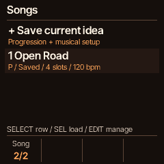
  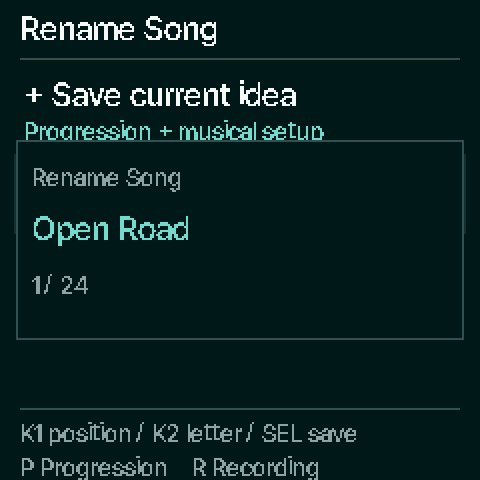
  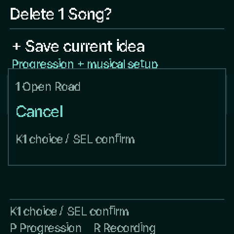
</p>

1. Select **+ Save current idea**, then press SEL. Each save makes a new copy in one of **six idea slots**.
2. Stop playback, release roots/HOLD and let the tails fade. Wait for **Saved**; Pending is still in RAM.
3. Select a **P** progression row and press SEL while stopped and quiet to recall it. Return HOME and press PLAY.
4. Press **EDIT** on a saved idea for **Load / Duplicate / Rename / Delete**. K1 chooses the action; SEL executes. Rename uses K1 for position, K2 for character and SEL to save.

An idea retains the phrase, key/scale/metre, tempo, groove/kit/swing, chord and bass sounds with edits, levels, Harmony, arp and FX. Saving a new copy does not update the highlighted older row. If all six slots are full, explicitly delete an idea you no longer need.

**R** rows are fixed-note recordings. SEL opens their recording workspace; their pitches do not transpose like editable progression ideas. Save an unsaved working draft before recalling another idea when prompted. [Songs guide](docs/SONGS-LIBRARY.md)

## Record your playing

**REC records your manual chords over the selected drums.** It suppresses automatic progression chords for that take; it does not capture a complete arranged performance of the automatic progression.

1. Choose the groove and sounds on HOME, then press REC.
2. After a **one-bar count-in**, play your roots and modifiers.
3. Press REC again to finish in whole bars, or let the take finish at **eight bars**. Hold REC to cancel the new take.
4. Stop replay and let the instrument become quiet so the completed take can save automatically.

The latest **three** completed takes are kept, newest always **Recording 1**. A fourth completed take replaces the oldest by default. Empty/cancelled takes preserve the previous set. In **GLO → Recordings**, turn **AUTO DEL Off** to protect a full set until you clear one.

Open an R row in Songs with SEL, or go to **GLO → Legacy tools → Recordings → SEL**. ALGORITHM selects a take, SELECT a track, EDIT its grid and PLAY its replay. To clear one take, stop, select it and **hold SAVE for three seconds**. Release early to cancel; clearing has no Undo.

Record the full live mix to a computer over USB when you want the exact heard combination of automatic progressions, FX and live drum moments. Firmware backups preserve device data; they are not WAVs, MIDI files or DAW projects. [Recording and backup details](docs/RECORDINGS.md)

## Connect to your computer

### USB audio

Connect the FM-1 with a data-capable USB cable. Select its audio device in your DAW; the device names are **CORD FM-1** (MIDI) and **CORD In** (audio). Older installed releases can retain their previous names until updated.

| DAW input pair | What you record |
| --- | --- |
| **1 / 2** | Full stereo master: chords, bass, drums and audible effects/click |
| **3 / 4** | Chord stem, before shared effects and MASTER |
| **5 / 6** | Bass stem, before shared effects and MASTER |

Choose **1/2** for a normal stereo recording. USB capture supports **44.1 and 48 kHz**; start at 44.1 kHz. USB MIDI remains available. [USB setup and GarageBand guide](docs/USB-AUDIO.md)

### MIDI and sync

**GLO → MIDI** controls MIDI output, clock, incoming-note mode and input channel. **GLO → Channels** assigns chord, bass, layer and drum channels.

- **Clock Off:** standalone internal tempo. **Out:** send the instrument's clock. **In:** follow an external clock and transport.
- **EXT WAIT:** waiting for incoming clock. Local tempo editing is unavailable while external clock owns it.
- After clock loss, send an explicit **MIDI Start or Continue** to resume. Clock pulses alone do not restart playback.
- **Notes In:** FM-1 keys emulates the key layout; Roots uses incoming roots; Direct plays notes directly.

## Make it yours

Choose **GLO → Display → K1 Character**: **Devil / Ember** or **Cat / Plum**. The palette follows you through HOME, drums, the editor, Lab, effects and Songs.

<p align="center">
  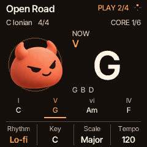
  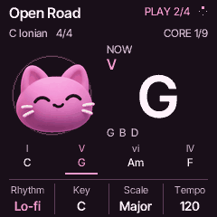
  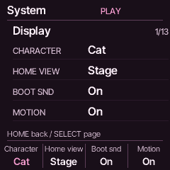
</p>

**Motion On** responds to real playback and output; **Motion Off** settles animation while chord names, controls, transport and save status keep updating. **K2 Home View** selects the retained HOME visualization; the native progression workspace is the normal starting screen.

### The CORD startup

<p align="center">
  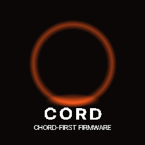
  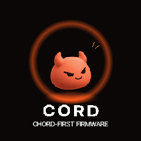
</p>

The compact Devil boot ends with **white CORD lettering** and opens Core. A key, button or encoder skips it. Motion Off shows the finished composition. The optional warm six-note **D3–F3–A3–C4–F4–A4** strum rises over 620 ms and fades by 2.2 seconds.

**GLO → Display → K3 Boot Snd** turns the chime On/Off; turning it On previews it. MASTER controls its level, and playing takes priority. [Listen to the firmware chime](docs/audio/cord-boot-chime.wav)

### Settings reference

Turn SELECT in GLO to select a page. K1–K4 edit the labels shown underneath.

| Page | Controls / purpose |
| --- | --- |
| **Display** | Character, HOME view, boot sound, motion |
| **MIDI** | Output, clock, notes-in mode, input channel |
| **Channels** | Chord, bass, layer and drums MIDI channels |
| **Play** | Velocity, glide behavior, lights and retrigger policy |
| **Reset** | Explicit factory-reset workflow |
| **Sound library** | Chord, bass and layer bank filters; reset filters |
| **Diagnostics** | Overview, Timing, Memory, USB; hold/reset a session and set refresh rate |
| **Harmony** | On/Off and restore defaults; SEL opens assignments |
| **Variation** | Context, amount, generate and undo |
| **Accompany** | Mode, rhythm, tempo and glide |
| **Browse** | Catalogue jumps, order and favorites |
| **Recordings** | Automatic deletion policy for the three recent takes |
| **Legacy tools** | Open Recordings, Metronome or Drum grid |

<details>
<summary>See the system screens</summary>

<p align="center">
  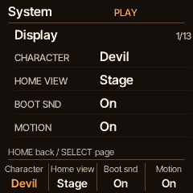
  
  
  
  
  
  
  
  
  
  
  
  
</p>

</details>

## Install on your FM-1

1. **Back up first.** Keep a current backup of sounds, settings and recordings, and a known-working firmware package.
2. Download the **`.fwsc`** asset from the [CORD releases page](https://github.com/chasedeanda/cord-fm1/releases). Read that release's notes for its exact features.
3. Open the [CORD installer](https://chasedeanda.github.io/cord-fm1/install/) in Chrome or Edge on a computer. Connect the FM-1 with a USB data cable.
4. The page selects the latest published CORD release and verifies its checksum. Press **Install CORD … now**, or expand **Another version, or a build of your own** to select your own `.fwsc`. Check the selected version/filename before installing.
5. Keep the cable connected and the page open until the updater finishes and the FM-1 restarts.

A `.bin` app image or GitHub source ZIP is not an installer package. The compatible `CoralFlower` INFO prefix remains in use. CORD 1.0.3 and later use `FM-1_26730001`, checked against the Hub’s live reserved-range checker. CORD 1.0.2 used `FM-1_936` (inside sloopDX’s reserved range); earlier releases used CoralFlower’s `FM-1_930`. Use the updated backup tools for recent recordings and FX data; older clients may not recognize newer backup objects.

## When something isn't working

| What you see or hear | What to try |
| --- | --- |
| **No sound in the browser** | Press Start, check browser/system volume and MASTER, then click the panel before using computer keys. |
| **PLAY waits / EXT WAIT** | For standalone use, set GLO → MIDI → Clock Off. For sync, send external clock and Start. |
| **Texture control says Off / Byp** | Enable the effect or recall an FX preset first. |
| **AUTO? / single notes** | Use Quantize Basic/Full and a seven-note scale for Auto Harmony. |
| **Bass is missing** | Check HOME → Mix → Bass link, bass level and the selected patch/register. |
| **Drums stay off after a drop** | HOME → Perform → K3 Back. Also check Rhythm and drum level. |
| **A change says Next / Queued** | It waits for the displayed musical boundary or safe release. A queued Variation can be cancelled with K4. |
| **Pending / RAM PENDING** | Stop playback, release roots/HOLD/Latch and let effect tails fade. Wait for Saved / CHECKPOINT before powering off. |
| **REC doesn't capture the automatic chords** | The current recorder captures manual playing. Use USB audio for the full arranged performance. |
| **Dense chords and drums thin out** | Reduce overlapping release tails or try a lighter patch. Current main separates the static melodic/drum budgets; real device overload protection can still shed voices. Capture Diagnostics with the patch, groove, FX and USB setup when reporting it. |
| **Recording slots are full** | Clear a selected take deliberately, or enable AUTO DEL to replace the oldest after a successful new take. |

Diagnostics can show timing, voice shedding, memory and USB counters. Host/browser CPU values are not device measurements. [Diagnostics guide](docs/DIAGNOSTICS.md) · [Report an issue](https://github.com/chasedeanda/cord-fm1/issues)

## Signature 8 development pilot

This development branch puts [eight fixed-recipe Signature sounds](docs/signature8/README.md) first in chord/layer browsing. Fresh settings start on EMBER KEYS (Chords) and GHOST CHOIR (Layer); existing saved sound selections and IDs are preserved. **GLO → Sound library** defaults to Primary; Signature 8 isolates the eight and All retains the full library. These source changes are separate from the published 1.0.3 package.

## Build the firmware

For development, clone current main and use the pinned generator dependencies and JieLi toolchain. On Apple Silicon, start Docker Desktop; the device compiler runs in a Linux x86-64 container.

```sh
git clone https://github.com/chasedeanda/cord-fm1.git
cd cord-fm1
python3 -m venv ../fm1-build/venv
../fm1-build/venv/bin/pip install Pillow==11.1.0 fonttools==4.66.1
sh tools/get_toolchain.sh ../fm1-build/jieli
PYTHON="$PWD/../fm1-build/venv/bin/python" \
JIELI_TOOLCHAIN="$PWD/../fm1-build/jieli/toolchain" \
./build.sh
```

The installable output is **`build/cord.fwsc`**. Fonts and tables generate as part of the build. Keep the source revision and build checksums with your package. [Mac toolchain details](docs/CHASEFLOWER.md#build-on-an-apple-silicon-mac)

The **Browser playground** GitHub Actions workflow builds and publishes main to [GitHub Pages](https://chasedeanda.github.io/cord-fm1/play/). Its footer links the deployed revision. For local WebAssembly work, install Emscripten and follow the [emulator guide](tools/emu/README.md). `tools/make_play_site.py` packages the custom browser site.

GitHub Actions runs host regressions. Generate headers with `python tools/build.py --gen-only` before local `tools/test_*.sh` checks. Native README screenshots can be regenerated with `python tools/render_house_style.py`; ARP and FX capture scripts are alongside it in `tools/`.

## Further reading and credits

Feature guides sometimes retain historical build notes or older page numbers. This README's nine-page HOME table describes current main; release notes describe packaged versions. Design boards and implementation plans are proposals, not a list of shipped features. Full arranged recording, A/B song arrangement and a separate chord-library picker are not current features.

[All releases](https://github.com/chasedeanda/cord-fm1/releases) · [Screenshots in both themes](docs/images/house-style) · [House style](docs/HOUSE-STYLE.md) · [Boot implementation](docs/CORD-BOOT.md) · [Chord/drum budget](docs/CHORD-DRUM-BUDGET.md) · [Licensing](LICENSING.md) · [Public-release audit](docs/PUBLIC-RELEASE-AUDIT.md)

CORD builds on [CoralFlower](https://github.com/FicusFicusov/CoralFlower), [ChoralRoot FM-1](https://github.com/Quixotic7/ChoralRootFM1) by Quixotic7, and [Felucca](https://github.com/hugelton/Felucca) by Leo Kuroshita / Hügelton Instruments. The FM engine comes from [Melodee](https://github.com/keremimo/melodee) by Kerem Kilic. Imported Aquanode voices retain their CC0 attribution in the sound catalogue. The interface uses Inter Tight and inherited Departure Mono assets; see [licensing and acknowledgements](LICENSING.md).

Free software under **GPL-3.0**; see [LICENSE](LICENSE). M-VAVE and FM-1 belong to their respective owners. This project is not affiliated with M-VAVE, Cuvave or Telepathic Instruments.

## Firmware Hub listing

The repository’s `fmhub.json` supplies the CORD card, browser link and quick-start guide. [Submission preparation and hardware acceptance](docs/FIRMWARE-HUB-SUBMISSION.md) records the current identity, flash support and remaining device tests. Back up before switching firmware: CORD cannot read every other firmware’s projects or samples, and installing or using another firmware may overwrite saved data.
