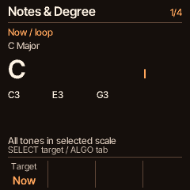
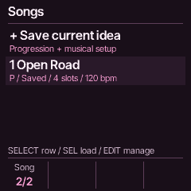

# Chase FM-1

Chase's personal firmware for the **M-VAVE FM-1**, built on [CoralFlower](https://github.com/FicusFicusov/CoralFlower).
Explore chord progressions, build a groove, play over it, edit your own phrase and learn what makes the chords work.

**Development build:** [Devil/Ember and Cat/Plum mascots](docs/MASCOTS.md), antialiased type and a
[shared screen style](docs/HOUSE-STYLE.md), plus [live fills, drum drops and downbeat returns](docs/DRUM-PERFORMANCE.md).
These changes require building this source; they are not in the chase10 download below.

**Release 0.6-chase10: Warm CORD boot chime, responsive HOME motion, Songs and Chord Lab.**

**[Download the firmware (.fwsc)](https://github.com/chasedeanda/chaseflower-fm1/releases/download/v0.6-chase10/coralflower-0.6-chase10.fwsc)** ·
[Release notes](docs/releases/0.6-chase10.md) · [Build current main](#build-current-main)

This guide covers the new interface. The older 0.6-chase7 download has different controls and scene animations.

<p align="center">
  
</p>

**Devil / Ember and Cat / Plum during playback.** The eight-second loop shows actual firmware motion,
chord changes and playheads. Choose your character in **GLO → Display → K1 CHARACTER**;
its colors follow you through the screens below. **Motion Off** stops the animation while chords and playback status keep updating.

<p align="center">
  
  
  
</p>
<p align="center">
  
  
  
</p>

These are native firmware captures from the computer emulator, including the animated preview.
They show the current development source; physical display, listening and timing review of the combined build remains pending.

## Make a beat in your first five minutes

**0:00 — Find your starting point.** Start on **HOME**, with **CORE** shown in the bank cue.
From another page, HOME returns here; while already on HOME, tap it to cycle banks until CORE appears.
Bring **MASTER** up gently. Turn **SELECT** to choose a progression; its key, scale and metre follow the idea.
Try a 4/4 idea for this first pass.

**1:00 — Give it a groove.** In CORE, turn **K1 RHYTHM** to a named beat such as **Lo-fi** or **HipHop**;
use **K4 TEMPO** to try about **85–100 BPM**. Press **SEQ**, turn **ALGORITHM** to **Loop**,
and set **K1 MODE** to **Chord+Drum**. Press **HOME**, then **PLAY** to hear the progression and groove.
Press PLAY again whenever you want to stop.

**2:00 — Make it yours.** Tap HOME once for **SOUND**.
Turn **K1** for the chord sound and **K2** for the bass sound; K3/K4 balance their levels.
Tap HOME again for **TEXTURE** and add a little reverb or delay. If its value says **Off** or **Byp**,
enable that effect in **FX** or recall an FX preset first.

**3:00 — Change the pocket.** Tap HOME again for **GROOVE**.
Try another **kit** with K1, balance **drums** with K2, and add **swing** with K3.
K4 adds a **click** alongside the beat. While playing, kit/swing changes take effect at the next bar;
the pending cue tells you what is queued.

**4:00 — Play and keep a take.** Tap HOME until CORE returns and press **REC**.
After the one-bar count-in, **play the chords yourself** over the selected groove: upper keys choose a chord
type/modifier, lower keys play roots. REC switches off the automatic progression chords for this manual take.
Press REC again to finish in whole bars, or let it finish at eight bars. Hold REC to cancel the new take.
Use **PLAY** to stop replay, then let the instrument go quiet briefly so the completed recording can save.

Your newest take is **Recording 1**. Press **HOME**, then **SAVE** for **Songs**.
SELECT highlights its **R** recording row; **SEL** opens it and **PLAY** replays it.
You have made a groove, picked its sounds and captured your own playing.

## Get around the new interface

**K1–K4 are the four controls labelled along the bottom of the current screen.** Their jobs change with the page;
the labels show exactly what each one will change.

| Control | Starting point / main use |
| --- | --- |
| **HOME** | Return to Progressions/Core; on HOME, cycle **Core → Sound → Texture → Groove → Perform → Keyboard** |
| **SELECT** | On HOME, browse ideas from any bank; elsewhere, choose the item, slot or page |
| **PRESETS** | On HOME, change the chord sound |
| **ALGORITHM** | Change tabs in Accompaniment, the phrase editor or Chord Lab; in FX, switch Macros / Individual |
| **PLAY** | On HOME/Accompaniment, start or stop the selected phrase; in Recordings, replay the selected take |
| **SEQ** | Open **Groove / Loop / Mix / Click**; press again to return HOME |
| **EDIT** | From HOME/Accompaniment, open a protected working copy of the phrase |
| **SEL** | From HOME, open **Chord Lab**; on action/confirmation pages, perform the displayed action |
| **SAVE** | From HOME/Accompaniment/editor/Lab, open **Songs**; sound and FX pages retain their own save controls |
| **ENV / LFO / ARP** | Envelope / linked bass / arpeggiator |
| **FX** | Open the combined Macros readout; ALGORITHM opens Individual editing |
| **GLO** | System pages: Display, MIDI, Harmony, Variation, Browse, Recordings policy and Legacy tools |
| **MASTER / OCT− / OCT+** | Output volume / playing register |

### Follow the arpeggio

The development ARP screen uses a large piano roll: follow the current note and
octave while the full chord name stays visible. **ALGORITHM** or **SELECT** switches
between **Pattern** (On/Off, Mode, Octaves, Rate) and **Timing & hold** (Gate, Swing,
Latch, sound Glide); the roll stays on both pages. Tempo remains on HOME Core K4.
The global ARP now also plays scheduled progression chords, with bass held beneath.
Four added modes—**Converge, Diverge, Low pedal, High pedal**—join the original nine.
See [controls, patterns and native previews](docs/ARP.md). This development change
is not included in the 0.6-chase10 download above.

### The six HOME pages

| Bank | K1 | K2 | K3 | K4 |
| --- | --- | --- | --- | --- |
| **Core** | Rhythm | Key | Scale | Tempo |
| **Sound** | Chord sound | Bass sound | Chord level | Bass level |
| **Texture** | Reverb mix | Delay mix | Chorus mix | Glide |
| **Groove** | Drum kit | Drum level | Swing | Click level / Off |
| **Perform** (development) | One-bar fill | Drop drums | Bring back | Tempo |
| **Keyboard / Learn** | Inactive | Inactive | Inactive | Inactive |

Switching banks leaves the music playing. SELECT still browses ideas in every bank.
Perform gestures start on the next bar; fills return automatically. The published chase10 has the first four banks.
For separate chord/bass/drum levels and linked bass On/Off, use **SEQ → Mix**.
For drums alone, use **SEQ → Loop → K1 Drums only**. **K4 Repeat Off** plays the full phrase once.
For a metronome alongside any groove, use **SEQ → Click**: K1 On/Off, K2 level, K3 sound, K4 tempo.

## Know what the keys do (current source)

Tap **HOME** until **KEYBOARD 6/6** appears, just after Perform. All **27 keys**
appear in their physical positions: upper chord choices and HOLD, lower root
notes with scale degrees. Labels follow your actual key, scale, octave and
Manual/Harmony assignments.

**Play a key** to hear it normally and see its full name and an explanation.
For example, Sus2 replaces the third with a second; Add9 keeps the third and adds
a ninth. The current chord and actual notes remain visible. **All four knobs do
nothing on this page**; the space belongs to the guide. HOME returns to Core.

[Native previews and controls](docs/KEYBOARD-LEARN.md). This source feature is not
in the chase10 download; physical FM-1 review is pending.

## Fills, drops and builds (current source)

Tap **HOME** until **PERFORM 5/6** appears. While a groove is playing, turn a knob
in either direction to trigger one action; multiple detents in a turn still queue one moment.

- **K1 Fill:** queue one bar, with the current groove/kit/swing. Lo-fi uses loose
  snare/tom movement; trap uses tighter snare/hat rolls. The groove returns automatically.
- **K2 Drop:** drums leave at the next bar; chords and bass keep their place.
- **K3 Back:** restore the groove on the next downbeat with an outward bloom.
- **K4 Tempo:** keep shaping the pace; external clock retains tempo ownership.

The header distinguishes **FILL NEXT / DROP NEXT / BACK NEXT** from **FILL / DRUMS OFF**.
Fill tension and the return bloom follow the real musical events; **Motion Off**
keeps the same actions and static status. [Controls, native previews and verification](docs/DRUM-PERFORMANCE.md).
These source changes are not in the chase10 download. Breakdown to chords alone is later work.

## A few things to try next

### Turn a factory idea into your own phrase

1. Choose an idea on HOME and press **EDIT**. SELECT chooses an explicit numbered slot.
2. Turn **ALGORITHM** between **Edit Chord, Timing, Voicing, Bass and Phrase**.
3. On **Edit Chord**, try K2 Quality or K3 Color. On **Timing**, change the unit/length or shorten the gate.
   On **Voicing**, try **Smooth** inversion for closer movement between chords.
4. Press **PLAY** to hear the whole draft. The focus box is what you edit; the underline is what is actually playing.
5. To duplicate a slot, go to **Phrase**, choose **Duplicate** with K1 and press **SEL**.
   Choose **Undo** and press SEL to undo the last phrase change. Remove asks for confirmation.

The factory original stays intact. The working draft supports **up to sixteen slots**.
The working draft checkpoints automatically after playback stops, keys/HOLD are released and tails fade.
If it says **RAM PENDING**, wait for **CHECKPOINT** before powering off.
After reboot, the protected copy is available as **RECOVERED**.
If you try editing another source while a dirty draft exists, **Return to draft** is the default choice.

To keep separate ideas, use **Songs** below. Arranged performance recording remains pending;
REC currently captures your manual playing over the groove.
[Detailed editor controls](docs/design/chord-first/native-editor/README.md).

### Save an idea with its sounds and groove

1. Press **SAVE** from HOME, Accompaniment, the editor or Chord Lab to open **Songs**.
2. SELECT **+ Save current idea**, then press **SEL**. This creates a new copy in one of **six idea slots**.
3. Stop playback, release keys/HOLD and let the tails fade. **Pending** means the copy is still in RAM;
   wait for **Saved** before powering off.
4. To recall, highlight a **P** progression row and press **SEL** while stopped and quiet, then PLAY from HOME.
   Save a dirty working draft first if recall asks you to.
5. For **Load / Duplicate / Rename / Delete**, highlight the idea and press **EDIT**. K1 chooses an action;
   SEL executes. Rename uses K1 for character position, K2 for the character, and SEL to save.
   Delete names the target and starts on Cancel.

A saved idea includes the phrase, key/scale/metre, tempo, groove/kit/swing, chord and bass patches/edits,
levels, Harmony, arp and FX. Every **Save current idea** creates a separate copy; it does not update an old row.
Existing takes appear as **R** rows and retain their fixed recorded pitches. [Songs and save details](docs/SONGS-LIBRARY.md).

### Get a spacious or lo-fi sound quickly

Press **FX** for the visual Macros screen. **SELECT browses** thirteen factory presets,
including **Deep Space**, **Orbit**, **Phone LP** and **Phone HP**; **SEL loads** the
highlighted recipe. K1–K4 are **Space, Echo, Motion, Warmth**. **ALGORITHM** switches
to Individual editing and back; effect order is fixed for factory recipes.
One large combined readout follows the sound and settles at silence; **Motion Off**
keeps it static. **SAVE** retains the sixteen-slot user bank and explicit management.

Press **ENV** for attack/decay/sustain/release; turn SELECT to choose the sound target.
For deep FM6/VA editing, use **ENV → EDIT**. To save just a synth sound, press **SAVE from ENV or the sound editor**,
choose **New**, edit its name/target, then **hold SAVE for one second**. SAVE in FX instead manages an FX user slot.
[FX preset controls](docs/FX-PRESETS.md) · [Sound banks](docs/CHASE3.md).

### Play richer chords with Auto Harmony

Open **GLO → Harmony**, turn **K1 On**, then return HOME.
In CORE, set **K2 KEY to E** and **K3 SCALE to Major**. Each root now makes a complete major/minor chord;
the upper modifier buttons add colors. Tap **7**, then try roots **E → B → D♯** in E Major:
you get **Emaj7 → Bmaj7 → D♯m7**. In Top Lock, a modifier stays selected until you change or clear it.

**HOLD** sustains the live chord after you release the root. Turn HOLD off to release it.
To change chord-button assignments, use **GLO → Harmony → SEL**.
Auto requires Quantize Basic/Full and a seven-note scale; **AUTO?** means single-note fallback.
[Auto Harmony and modifiers](docs/AUTO-HARMONY.md).

### See and hear why a chord works

Play a chord or start a progression, then press **SEL on HOME** to open **Chord Lab**.
ALGORITHM selects **Notes & Degree → Intervals → Compare → Next Chord**.

- **Notes / Intervals:** SELECT or K1 chooses **Now**, **Last** or a numbered planned slot.
  See the voiced notes and degree; in Intervals, K2 focuses a note. `*` marks a tone outside the selected scale.
- **Compare:** choose **Triad/Color** or **Root/Smooth** with K1, choose A/B with K2, and press **SEL** to hear
  that side for one bar. Use a chord with an extension for Triad/Color; identical choices are disabled.
- **Next Chord:** browse three local suggestions with SELECT/K1. K2 chooses **Live history** or **Draft path**.
  Press SEL to hear a candidate. To use it, explicitly choose the destination with **K3 INSERT**, then press **EDIT**;
  it replaces that numbered slot and opens the editor. **Phrase → Undo → SEL** restores the prior draft.

Release live roots/HOLD before auditioning, and finish recording/replay first.
Browsing alone is silent; Next works offline and needs a seven-note scale.
Keep an existing dirty draft open before inserting into it. [Chord Lab details](docs/CHORD-LAB.md).
The separate chord-library picker remains deferred.

## Recordings, saving and quick tips

- **Your latest three takes:** newest is always 1. By default a completed fourth take replaces the oldest;
  an empty/cancelled take preserves the previous recordings. In **GLO → Recordings**, set **AUTO DEL Off**
  to keep a full set until you clear one yourself.
- **Replay or edit:** open its **R** row in **Songs** with SEL, or use **GLO → Legacy tools → K1 Recordings → SEL**. ALGORITHM chooses the take,
  SELECT chooses a track, EDIT opens its grid, and SAVE returns to the list. GLO shows help there.
- **Clear one take:** stop playback, select it in Recordings and **hold SAVE for three seconds**.
  Release early to cancel. Clearing has no Undo; hold REC cancels only a new take in progress.
- **Favourite a catalogue idea:** use **GLO → Browse** and press SAVE on the selected entry.
  SAVE on HOME now opens Songs; sound-only and FX saving remain on their respective pages.
- **Read the queue:** **Next bar / Next chord / Next:** is a pending change. The current chord/cursor still describes
  what is sounding. A focus box or a matching chord name does not start playback or audition.
- **External clock:** **EXT WAIT** means the FM-1 is waiting for incoming MIDI clock. For standalone use,
  go to **GLO → MIDI** and set CLOCK Off. After clock loss, send MIDI Start/Continue to resume.
- **Make the display yours:** in development source, **GLO → Display → K1 CHARACTER** selects Devil/Ember or Cat/Plum.
  The palette follows the character. The published chase10 instead has Instrument/Studio/Editorial themes. K4 sets **Motion On/Off**.
  Off settles all visual animation while notes, recording and transport keep updating.
- **CORD startup:** piano keys assemble inside a complete ring in your saved theme, then open HOME / CORE.
  Touch a key, button or encoder to skip. Motion Off shows the finished logo during startup.
- **Boot sound:** the short warm Dm7 chime matches the piano-key logo. **GLO → Display → K3 BOOT SND**
  turns it On/Off; On previews it. MASTER sets its level, and playing takes priority.
  [Listen to the chime](docs/audio/cord-boot-chime.wav).
- **HOME feedback:** with Motion On and audible output, a round pulse expands and fades with sound and the beat.
  A small top-right indicator follows the playing clock. Filled progression cards match the chord you are playing;
  the underline remains the sequence's actual position. Matching still works with Motion Off.
- **Record to a computer:** USB inputs **1/2 are the complete stereo mix**, **3/4 the chord stem**, **5/6 the bass stem**.
  Choose 1/2 for a normal recording with drums and effects. USB MIDI stays available.
  [GarageBand / USB setup](docs/USB-AUDIO.md).

Completed takes save automatically when playback stops and the instrument is quiet. Wait before powering off.
Keep a current firmware backup: it preserves sounds/settings/recordings, rather than creating WAVs or a DAW project.
[Recording policy and backups](docs/RECORDINGS.md).

## Build current main

Wait for the changes you want to merge, then use a clean checkout of `main`. On an Apple Silicon Mac,
start Docker Desktop; the JieLi compiler runs in a Linux x86-64 container.

```sh
git clone https://github.com/chasedeanda/chaseflower-fm1.git
cd chaseflower-fm1
python3 -m venv ../fm1-build/venv
../fm1-build/venv/bin/pip install Pillow==11.1.0 fonttools==4.66.1
sh tools/get_toolchain.sh ../fm1-build/jieli
PYTHON="$PWD/../fm1-build/venv/bin/python" \
JIELI_TOOLCHAIN="$PWD/../fm1-build/jieli/toolchain" \
./build.sh
```

The installable package is **`build/coralflower.fwsc`**. Keep the build output/checksums with the source revision
you used. If your environment is already configured, only the final build command is needed.
The build generates its own fonts/tables; you do not need to generate them separately first.
[Mac setup details](docs/CHASEFLOWER.md#build-on-an-apple-silicon-mac).

For host checks without a device build, activate that Python environment and run `python tools/build.py --gen-only`,
then the relevant `tools/test_*.sh` scripts. Examples: `test_native_pages.sh`, `test_home_banks.sh`,
`test_accomp_workspace.sh`, `test_editor.sh`, `test_lab.sh`, `test_recordings.sh` and `test_usb.sh`.
GitHub Actions runs the complete regression suite. [Local emulator](tools/emu/README.md).

## Install your build

1. Save a current backup of your sounds, settings and recordings.
2. Open the [upstream installer's custom-build section](https://ficusficusov.github.io/CoralFlower/#own)
   in Chrome or Edge on a computer, and connect the FM-1 with a data-capable USB cable.
3. Expand **Another version, or a build of your own**, choose the downloaded **`coralflower-0.6-chase10.fwsc`**
   or your own **`build/coralflower.fwsc`**, and install
   from that section. Check the selected file first: the installer's default download is upstream CoralFlower.
4. Keep the cable connected and the page open until restart. The **CORD** piano-key boot screen leads to native **HOME / CORE**.

The separate app `.bin` and GitHub source archives are not installer packages.
This release reports **CoralFlower 0.6-chase10**. The compatible `CoralFlower` INFO prefix, `FM-1_930` package identity
and USB names remain in use; an unversioned development build can retain an older version label. The published
[0.6-chase7 package](https://github.com/chasedeanda/chaseflower-fm1/releases/download/v0.6-chase7/coralflower-0.6-chase7.fwsc)
has its own [release notes](docs/releases/0.6-chase7.md) and older controls/scene animations.
The [upstream browser demo](https://ficusficusov.github.io/CoralFlower/play/) also runs upstream firmware.

## More detail

[Chord Lab](docs/CHORD-LAB.md) · [Native screens](docs/design/chord-first/native-pages/README.md) ·
[Songs library](docs/SONGS-LIBRARY.md) ·
[Accompaniment](docs/design/chord-first/native-accompaniment/README.md) ·
[Phrase editor](docs/design/chord-first/native-editor/README.md) · [Diagnostics](docs/DIAGNOSTICS.md) ·
[Design / implementation plan](docs/design/chord-first/AGENT-START.md) ·
[All releases](https://github.com/chasedeanda/chaseflower-fm1/releases)

## Credits and licence

CoralFlower is a fork of [ChoralRoot FM-1](https://github.com/Quixotic7/ChoralRootFM1) by Quixotic7, which is itself
a fork of [Felucca](https://github.com/hugelton/Felucca) by Leo Kuroshita (Hügelton Instruments). The FM engine comes
from [Melodee](https://github.com/keremimo/melodee) by Kerem Kilic. The native interface uses Inter Tight
([SIL OFL licence](assets/fonts/OFL.txt)); inherited screens/assets also use
[Departure Mono](https://departuremono.com) by Helena Zhang. Thank you all.

CoralFlower is free software under the GPL-3.0. `LICENSE` and `LICENSING.md` have the details.
M-VAVE and FM-1 are trademarks of their respective owners. Orchid is a product of Telepathic Instruments.
CoralFlower is not affiliated with M-VAVE, Cuvave or Telepathic Instruments.

Track Chase FM-1 changes in [this repository's issues](https://github.com/chasedeanda/chaseflower-fm1/issues).
Earlier ChaseFlower notes and plans remain in `docs/` as historical records.
