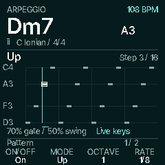

# Visual arpeggiator

Development implementation on latest main at `f1165e6`; not part of the published
0.6-chase10 release. Native emulator captures use the firmware renderer, Inter
Tight fonts and selected Instrument Teal palette, at 240 × 240 pixels.

Press **ARP**. The main display is a large roll: pitch rises vertically, time
advances horizontally, bar width shows gate and alternate starts show swing.
The current event is outlined, its note includes the octave, and the full chord
name/degree stays visible. The 16 columns are a window, not a new pattern length.

| Bank | K1 | K2 | K3 | K4 |
| --- | --- | --- | --- | --- |
| Pattern | On/Off | Mode | Octaves 1–4 | Rate; strum spacing in ms |
| Timing & hold | Gate 20–100% | Swing 50–75% | Latch | Chord-sound Glide |

Turn **ALGORITHM** or **SELECT** to change banks. This changes no sound setting
and leaves the roll in place. Tempo stays on **HOME → Core → K4** and follows
external MIDI clock when enabled. **ARP** again or **HOME** returns home.

Pattern sets note order, range and speed. Gate is how long each note lasts;
Swing delays alternate onsets; Latch continues a live chord after key release.
Glide is the sound's existing pitch-transition control, not an additional arp
pattern. Gate/Swing are unavailable in Strum because those notes sustain.

## Thirteen patterns

The original IDs 0–8 remain Up, Down, Inclusive, Exclusive, Random, Order,
Repeat, Strum up and Strum down. IDs 9–12 append these walks:

| Mode | Four-note example (low to high = 1, 2, 3, 4) | Behavior |
| --- | --- | --- |
| Converge | 1, 4, 2, 3 | Outer notes move inward |
| Diverge | 2, 3, 1, 4 | Center notes move outward |
| Low pedal | 1, 2, 1, 3, 1, 4 | Lowest tone alternates with an ascending walk |
| High pedal | 4, 1, 4, 2, 4, 3 | Highest tone alternates with an ascending walk |

Converging/diverging and repeated anchor-note styles are established arp ideas;
see the [Ableton Arpeggiator reference](https://www.ableton.com/en/live-manual/11/live-midi-effect-reference/#arpeggiator).
These are original generic walks over the user's chord, not transcribed songs,
copied preset banks or claims to exactly reproduce a particular synthesizer.
Single notes remain valid; notes above MIDI 127 keep the existing clocked-mode
fallback, and strums omit out-of-range notes. Existing saved modes retain their
meaning, and the settings record remains 188 bytes. Older firmware cannot know
the four appended modes and will sanitize them to its default.

## What playback follows

Global ARP now applies to scheduled progression chords as well as live chords.
It borrows the existing CHORDS arpeggiator owner, keeps bass sustained, and uses
the shared accompaniment clock. Live keys/HOLD/Latch take over that owner;
releasing the live owner returns to the current scheduled chord without changing
the phrase cursor. Stop, panic, phrase gate, MIDI Stop and external clock loss
release the scheduled notes. Recordings retain their per-track ARP flags.

Random displays actual event history and leaves its future blank. Strum shows
the actual queued notes accumulating, including its clipped octave limit and
settings that will only apply on the next chord. A disabled/waiting roll has no
running marker. Motion Off stops continuous cursor travel; current musical
notes/step/ownership update immediately. The renderer never advances the player,
draws random choices from its RNG or writes flash.

## Verification

`sh tools/test_arp.sh` checks independently specified walks, all chord lengths and
modes, preserved saved IDs/record size, both control banks, Random history,
strum controls, register/clipping, Latch/release, quiet redraw skipping, renderer
isolation, live takeover/resume and external clock stop/continue/loss. It compares
physical audio, all six USB channels and MIDI byte-for-byte while drawing versus
idle at 44.1 and 48 kHz capture rates, for live arps and scheduled progressions.
Native-page, live Auto/HOLD, accompaniment, learning and recording checks cover
the surrounding note owners. Linked memory and package results are recorded in
the [preview notes](../previews/arp-roll/README.md).

Run `python3 tools/render_arp.py` with Pillow after the host test to regenerate
the captures and animation. Actual FM-1 display appearance, subjective listening,
UI cadence and combined audio/USB timing still require hardware verification.
