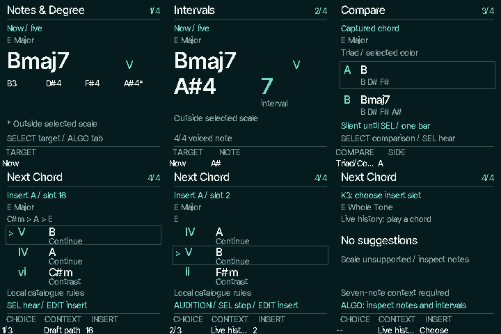

# Chord Lab engineering preview

Native firmware implementation of [learning #47](https://github.com/chasedeanda/chaseflower-fm1/issues/47)
and [offline Next #48](https://github.com/chasedeanda/chaseflower-fm1/issues/48), based on main
`abd37afab562555d4e8a58a66d18b488cce594f9` (integrated with main `09403c9` before merge) and design handoff
`845325136418dd038c7ef81eaca01ec64ac5e61e`. This is a development preview;
physical FM-1 verification remains pending. The original working checkout was left intact.

Press **SEL on Progressions HOME** to inspect Now. During silence it explicitly shows Last;
with no current/last sound it asks for a root or a planned slot. **ALGORITHM** selects
Notes & Degree, Intervals, Compare or Next Chord. **HOME** returns without resetting playback.
The previous chord-button editor remains at **GLO → Harmony → SEL**.

| Tab | Controls and behavior |
| --- | --- |
| Notes & Degree | SELECT or K1 chooses Now, Last or a numbered planned slot. Shows actual chord quality, degree, voiced notes with octaves, and `*` for tones outside the selected scale. |
| Intervals | Same inspection targets; K2 focuses an actual voiced note and its chord-relative interval. Ninth/eleventh/thirteenth keep compound labels even when inverted. |
| Compare | SELECT/K1 chooses Triad/Color or Root/Smooth; K2 chooses A/B; SEL explicitly hears one side for one bar or stops it. Both sides use one captured target and preceding voicing. Without an extension, Triad/Color is disabled; identical Root/Smooth choices are disabled. |
| Next Chord | SELECT/K1 explores three candidates silently. K2 chooses Live history or Draft path. K3 explicitly chooses the insertion slot. SEL auditions; EDIT replaces exactly that visible slot and opens Edit Chord. |

A Bmaj7 in E Major is labelled with B, D#, F#, A#, degree V and intervals 1, 3, 5, 7.
A# is visibly outside E Major. Inspection does not reinterpret Auto's complete major/minor
chords as strict diatonic stacks or change Harmony/modifiers.

Planned inspection and insertion focus are independent of sound and the playback cursor.
Repeated matching chords never choose a slot. **EDIT → Phrase → Undo → SEL** restores the
previous complete draft after insertion. A dirty draft from another source is protected;
open that draft before inserting. A live-history candidate in a different key/mode from
the draft requires Draft path context, avoiding silent degree reinterpretation.

Next scans the shipped local progression catalogue in the foreground. It compares recent
root/quality context and preceding degrees, ranks deterministically, includes a tonic
route when useful, and offers distinct continuations. It identifies local catalogue rules
or a theory-guided fallback, never percentages or population probabilities. No network,
account, Hooktheory data or additional global Auto style is used. Non-seven-note scales
have no candidates; Notes/Intervals still work. Candidates carry explicit local masks
without changing global Harmony or latched modifiers.

Only committed harmonic snapshots update the three-chord history. Repeated attacks,
arp events and inversion-only changes do not add entries; auditions are excluded. This
first pass follows foreground semantic snapshots: chord changes occurring entirely
between foreground frames can be missed. A lossless semantic-event history is later work.

Audition uses a bounded latest-request mailbox containing resolved notes. While audition
owns the chord, the accompaniment's chord and bass are silent, and its drums/cursor/clock
continue. Expiry restores the **current** scheduled harmony only while its gate remains
open, including when the clock has crossed a chord boundary. It never restores the old
snapshot. Live roots/HOLD block or cancel audition; recording/replay must finish first.
Stop, panic, navigation, MIDI transport stop and clock loss cancel owned notes. Auditions
and navigation never save content. Flash quiet checks include pending/active auditions.

**SAVE** from Lab opens the existing Recordings route. Numbered Songs management and the
full future save workflow remain separate pending work. Insertion opens the existing
editor with an inline acknowledgement, rather than a dedicated inserted-status page.
The native Lab is static and settles without further composition/hash/LCD transfer;
Motion On/Off still controls the existing HOME, with no extra Lab motion setting.

Verification:

- `sh tools/test_lab.sh`: exhaustive theory/membership over seven core modes, twelve
  keys, all modifiers/inversions; deterministic candidate/history validity; actual
  event/clock/ownership tests at both USB capture rates; exact audio comparison with
  browsing/drawing every Lab tab versus no browsing.
- Editor, semantic Song, accompaniment, accompaniment workspace, Auto harmony, USB,
  HOME/banks and scene-free regressions pass.
- ARM syntax and actual JieLi device build pass. Native images above are host renders,
  not photographs or evidence of device timing.
- Physical readability, input latency, sustained audition/USB stress and actual device
  audio/MIDI ownership remain pending. No hardware CPU or polyphony claim is made.

Resource details and reproducible device identity are in
[`benchmarks/resources/chord-lab/`](../benchmarks/resources/chord-lab/).
