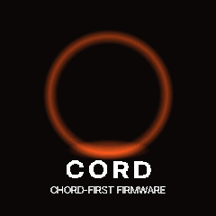
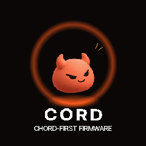

# Compact Cord devil boot and flash recovery

The supplied GIF is a visual reference. This implementation reuses the existing Devil idle
art and tracked CORD bitmap, draws the ring/glow with integers, and renders the subtitle
from the existing 11px face. No GIF frames are linked, and no new drawing buffer is allocated.
The reference is recreated rather than reproduced frame-for-frame. Final lettering is white
(0xFFFFFF / RGB565 0xFFFF), independent of the selected HOME character/theme.

## Missing boot screen

Previously the native intro deadline started in `cf_splash()`, before sound/hardware setup
and the live UI's saved-state loading. `main.c` later clears the LCD. A long initialization
could therefore consume the deadline before the UI got its first visible frame.
The visible playhead now starts at the end of `cf_ui_init()`. The initial splash already
contains the white CORD name; it is not an empty animation frame. The live animation lasts
1.8 seconds and remains skippable. Motion Off shows its final static composition during
startup. SAFE MODE, UI-palette restoration and the selected boot chime are preserved.
A regression simulates 10 seconds between splash and UI initialization and verifies that
live playback still begins at 0 ms. Large frame delays saturate rather than wrapping.

## Flash saved without removing musical features

The 64px font is called for chord roots and the Click On/Off status. Its full ASCII bitmap
used 37,427 bytes. Retaining the required letters plus conservative numeric/accidental
coverage reduces it to 11,960 bytes: **25,467 bitmap bytes removed**. All 29 retained glyphs
keep their original metrics and pixels. A complete string with an omitted character uses
the full 32px face for width, ordinary text and horizontally squeezed text; it never
silently renders missing glyphs. The other five font sizes retain their full character sets.

Paired actual JieLi builds against main `fb05267` (same compiler/settings):

| Region | Main | Compact boot + font cleanup | Change |
| --- | ---: | ---: | ---: |
| XIP flash | 570,128 | 544,128 | -26,000 bytes |
| Ordinary RAM | 90,208 | 90,192 | -16 bytes |
| POOL | 316,792 | 316,792 | unchanged |

The app slot now has **29,312 bytes free**, up from 3,312. The large GIF implementation is
excluded. Sounds, grooves, effects, MIDI/USB, recovery and the update loader are retained.
The build passes memory-layout, register-access and protected-sector checks; the boot stub
sector hash remains `0f33c838a23961d8` (prefix).

Other candidates for a separate measured pass: the linked older antialiased font data
`AF_M_DATA` (13,039 bytes) and `AF_S_DATA` (10,425), and the two mascot atlases (45,965 total
pixel-data bytes). They still have live references; those sizes are **not** promised savings.
Compressing/deduplicating them or removing their remaining legacy drawing routes requires
separate verification. Simply hiding menus or deleting unlinked source will not free flash.

## Verification

- 5,343,523 Cord boot/font checks: both HOME themes, white RGB565 text, frame bounds,
  cached static drawing, input/end/Motion/SAFE exits, saved appearance, delayed startup,
  elapsed-time overflow and complete-string font fallback.
- Retained large glyphs compared to the untrimmed generated header: pixel/metric identical.
- Boot chime regression and unchanged physical/six-channel USB/MIDI first-key captures.
- Native pages/Motion, mascot bounds/motion and scene-free/legacy profile audio comparisons.
- AddressSanitizer boot checks; actual device-toolchain build and `.fwsc` packaging.

The previews are actual host firmware captures. TFT appearance, startup responsiveness and
listening on the physical FM-1 remain hardware checks. No release publication or flashing
is performed by this change.
