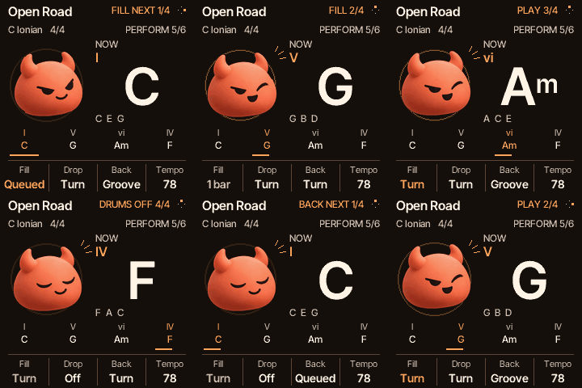
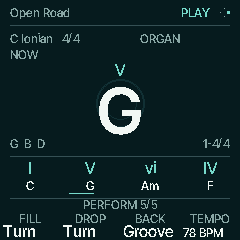

# Fills, drops and builds

Integrated with the Devil/Cat redesign on `codex/mascot-home`, from the local
`codex/drum-performance` snapshot based on `4502c2f` (CORD / chase10). This is a
native C firmware feature, with captures from the combined renderer and a linked
local test package. It is not in the published chase10
firmware and has not been flashed or physically verified on an FM-1.



## Use it from HOME

Choose a compatible rhythm in **Core**, press **PLAY**, and tap **HOME** until
**PERFORM 5/6** appears. HOME cycles **Core → Sound → Texture → Groove → Perform → Keyboard**;
from another workspace it returns to Core. The five musical banks keep the large actual chord, notes, planned phrase, live
matching and true cursor. Keyboard / Learn is the sixth HOME page and gives that
space to the key guide, with all four knobs inactive.

| Knob | Action | When it is heard |
| --- | --- | --- |
| **K1 FILL** | One-bar fill matched to the groove | Starts next bar; the original groove returns automatically one bar later |
| **K2 DROP** | Drop drums | Next bar; chords and bass continue at their existing phrase positions |
| **K3 BACK** | Bring the groove back | Next downbeat, at the current groove phase, with a finite outward bloom |
| **K4 TEMPO** | Tempo | Existing internal tempo control; MIDI Receive retains tempo ownership |

Turn either way to trigger K1–K3. A nonzero turn is one request regardless of the
number of detents. One moment can be queued; the latest eligible request replaces
it. Repeating Fill while a fill is queued does not add bars; while the fill is
active it cannot extend it. Drop during a fill takes over at its ending boundary.
Back can replace a pending Drop before drums leave. Fill is unavailable while
drums are dropped; bring them back first.

The header says **FILL NEXT**, **DROP NEXT** or **BACK NEXT** while waiting, then
**FILL**, **DRUMS OFF** or the normal transport status once committed. Knob values
show **Queued**, **1 bar**, **Off** and **Groove** separately from the action names.
Selecting a bank changes no sound, queue, note, preset or transport state.

## Musical behavior

- A fill spans one bar in the current metre. Its first half retains the groove;
  its second half turns around. Lo-fi keeps the current swing and adds loose
  snare/rim and descending tom movement. Trap, CloudTrap, Plugg, Rage, Drill and
  Grime use tighter snare/hat rolls. The selected kit and global drum level remain
  in effect. Legacy sequencer patterns choose the fill family from their kit.
- The existing drum grid is retained: sixteenths in 2/4, 3/4, 4/4 and 6/8;
  eighths in 5/4 and 7/4. Trap rolls use that grid, not new 32nd/triplet playback.
  Compound 6/8 keeps the existing quarter-note BPM interpretation.
- Drop suppresses only drum onsets and fades existing dry drum voices over one
  control block. Delay/reverb tails can decay naturally. It does not change saved
  track mutes, lane scores, melodic ownership or the shared clock.
- Fills and drops do not restart a two-bar groove or the progression. A simultaneous
  queued groove change commits first; the fill then uses the new groove's family
  and metre. Normal automatic chord changes, roots, modifiers and HOLD remain live.
- Playback and a real drum rhythm are required. Off/Click without a rhythm,
  clock waiting/lost/paused, count-in and recording do not accept moments.
  Stop, panic, recording ownership and clock interruption clear transient moments.
  MIDI clock pulses schedule the same boundaries as the internal clock.

**V1 is live performance.** Moments are not written into saved patterns or the
existing manual takes, and the controls are disabled during recording. Use the
existing USB/external audio capture to record the heard performance. Starting REC
retains its existing manual-take behavior and clears the moment state.

## Connected visuals

With **Motion On**, fill tension grows with real bar phase, the drum drop reduces
the round accent, and automatic fill return or Back produces one outward bloom.
The existing smoothed output activity gates these effects: muted/silent output
cannot generate a synthetic energetic animation. The actual chord remains readable;
all outlines fit within the native HOME hero region.



The audio event is consumed once, then animated in UI time; the device's audio
and UI clocks can have different boot origins. Hidden HOME, Motion Off and clock
interruption consume/cancel effects without replaying old blooms later. **Motion
Off** keeps exactly the same musical actions and static status, with no fill travel,
return bloom or effect-only redraw.

For this version, **Build** is the fill's rising musical/visual tension. A dedicated
multi-bar build and **Breakdown** to chords alone remain later work. There is no
placeholder Breakdown control.

## Reproduce the previews and verification

Generate the repository headers if needed, then run:

```sh
sh tools/test_perform.sh
mkdir -p build/performance-preview
sh tools/test_perform.sh --render build/performance-preview
```

The optional render produces native 240 × 240 PPM frames and two eight-bar stereo
WAVs: `lofi-fill-drop-back.wav` and `trap-fill-drop-back.wav`. Both use the real
shared progression clock and firmware DSP, with dry chords/bass and drums:
normal groove → queued fill → one-bar fill → return → drop → space → Back.
They are not normalized. The render asserts zero clipped samples. Convert PPMs
with Pillow when PNGs or a contact sheet are needed.

The dedicated suite passes **215,266 checks** (215,306 including the optional
renders). It covers every built-in groove through both legacy players and the
current shared accompaniment, exact boundaries/duration, normal-score recovery,
MIDI drum events, preserved chords/bass/patterns, request replacement, queued groove
changes, external clock, recorder exclusion, five-bank controls, settled Off,
clock-origin differences, muted output and hidden/missed bloom cancellation.

The following checks also pass on this source: HOME banks and identical-audio
comparison, native HOME, mascot artwork/typography/migration, native-page/Motion
On/Off physical-output/six-channel USB/MIDI comparisons at both rates, shared
accompaniment tests and USB-active/idle comparisons, recording/backup/power-cut
checks, the drum bank (149,906 checks), Auto Harmony and USB's 64 render comparisons.
The canonical inventory validates **207 screens/states and 39 workflows**.

The installed JieLi toolchain links a local verification package using default
build options. The resulting memory use is:

| Region | Used | Capacity |
| --- | ---: | ---: |
| XIP application | 562,024 B | 573,440 B |
| Ordinary RAM (.data + .bss) | 89,416 B | 98,304 B |
| POOL | 316,792 B | 344,064 B |
| RAM-resident code, including core 1 | 3,128 B | 24,576 B |
| NOINIT | 216 B | 15,664 B |

These are linked sizes, not physical CPU/display/USB timing measurements. Native
screens and dry renders establish host behavior; on-device listening, encoder
feel, display legibility, worst audio-half latency and simultaneous USB capture
still need hardware review before release.

[Combined build resource evidence](../benchmarks/resources/mascot-home/report.md).
