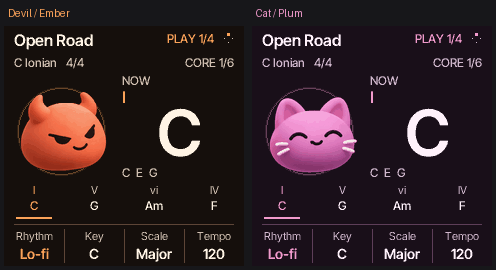

# Screen house style

The mascot HOME screen is the reference for every native screen. Selecting
Devil or Cat in System > Display selects the whole interface palette, including
text, surfaces, borders, curves, selections, dialogs, and control values.
`cf_palette_build()` owns those colors; screens use its semantic palette tokens.

All native text uses the antialiased Inter Tight faces. The shared footer in
`firmware/src/cf_style.c` owns the HOME treatment across screen families:

| Element | Metric |
| --- | --- |
| Top divider | y 198, x 10–229 |
| Four control columns | 60 px each, 3 px inner margin |
| Vertical dividers | x 60, 120, 180; y 203–236 |
| Labels | Inter Tight 11, baseline 214, secondary ink |
| Values | Inter Tight 14, fallback 12, centered, baseline 233 |
| Active knob underline | y 239, theme accent |
| Help text | Inter Tight 11, baseline 193, above the footer |

Use `cfn_controls()` for controls and `cfn_hint()` for the help line. Inactive
controls keep their disabled state; empty controls stay empty. Screen-specific
content and additional status lines must fit above the help line. Long text is
bounded within its column. Tempo retains external-clock states while omitting
the redundant BPM suffix in the footer.

Songs displays the controls actually available in each mode: row, action,
confirmation choice, or rename position and letter. Keyboard Learn retains its
full-screen guide and inactive-knob explanation. Boot, recovery, and update
screens retain their purpose-specific layouts.

## Native previews



The README gallery is captured from this source at the native 240 × 240 size in
both character palettes. The GIF pairs eight seconds of sample-driven playback
at 20 frames per second; movement, rings, chords and playheads come from the
firmware renderer. It has no audio track. No physical device is accessed.

After generating build headers, reproduce the assets with Pillow available:

```sh
python3 tools/render_house_style.py
```

The capture helper compiles the native emulator, saves raw frames under
`build/house-style-readme/`, and exports PNGs and the GIF to
`docs/images/house-style/`. A shared GIF palette prevents color shimmer between
frames. `manifest.json` records the dimensions, frame count and capture source.
