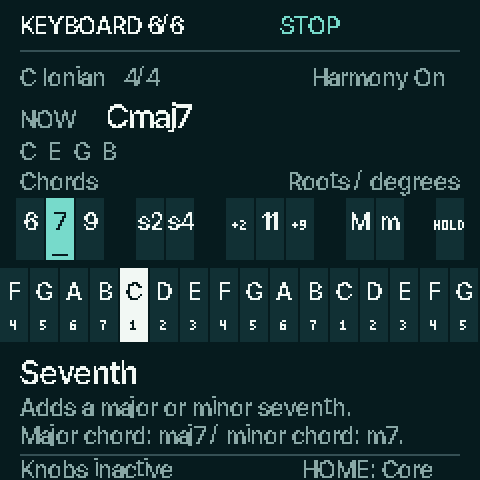

# Keyboard / Learn

Implemented in local source from main `eb51a3a` (including the fifth Perform
page). This is the **sixth HOME page**, not a released firmware update.



Tap **HOME** through **Core → Sound → Texture → Groove → Perform → Keyboard**.
The header says **KEYBOARD 6/6**. HOME once more returns to Core. HOME from any
other workspace still returns to Core.

All **27 keys** appear in the same staggered positions as the instrument:

- The 11 upper keys show their current chord choices/modifiers and HOLD.
- The 16 lower keys show their current root notes, with scale degrees below.
- Key, scale and octave changes update the root labels. Harmony On uses the
  current modifier assignments; Harmony Off uses the current manual forms.
- Latched/pressed keys retain their normal fills. The last key inspected also
  has an outline and underline; its full name and explanation stay after release.

**Play a key to learn it.** The same key event still reaches the normal chord
player. The page does not introduce an audition mode. The top shows the actual
Now/Last chord and sounded notes, separately from the physical input map.
Recording/queued-change status remains visible.

For example, a suspended second replaces the third with a second; Add9 keeps
the third and adds a ninth. In Harmony On, 7 follows chord quality: major chord
maj7 / minor chord m7. Manual form help names its assigned type and added tones.
Unsupported Harmony scale/quantize settings explicitly say unavailable.

**All four knobs do nothing on this page.** There are no parameter columns or
hidden musical edits. The freed area belongs to the keyboard and explanations.
SELECT, PRESETS, MASTER, OCT, transport and destination buttons keep their usual
behavior. HOLD and note releases remain owned by the existing chord player.

The older five-octave output-piano view remains available through Display's HOME
view setting. This sixth page teaches the physical controls and assignments.

## Verification

- Keyboard suite: **143 assertions**, covering inactive knobs during playback,
  current/edited Manual and Auto labels, all modifier explanations, unsupported
  contexts, real note/latched-seventh/HOLD/release handling, transposed register,
  six-page navigation and settled redraw/flash behavior.
- HOME suite: **270 assertions**, plus byte-identical audio with bank cycling and
  drawing through all six pages.
- Native HOME: **315 assertions**. Perform: **215,267 assertions**, preserving the
  fifth page's Fill/Drop/Back behavior and updated wrap through Keyboard.
- Native pages/Motion: **1,835 assertions across 877 routes**, plus identical
  physical audio, all six USB channels and MIDI at both capture rates with
  Motion On/Off.
- Canonical controls validate **207 screen/state definitions and 39 workflows**.
- Local JieLi package links: XIP **473,732 / 573,440 B**, ordinary data+BSS
  **88,360 / 98,304 B**, POOL **316,792 / 344,064 B**. No persistence format change.

These are host tests, native 240 × 240 framebuffer captures and a local device
link. Physical display legibility, playing and timing review on an FM-1 remain
pending. No hardware was flashed.

## Reproduce

Generate headers with the repository's Python/Pillow environment, then run:

```sh
python3 tools/build.py --gen-only
sh tools/test_keyboard.sh
sh tools/test_home_banks.sh
sh tools/test_stage.sh
sh tools/test_perform.sh
sh tools/test_native_pages.sh
mkdir -p build/keyboard-preview
sh tools/test_keyboard.sh --render build/keyboard-preview
```

The render writes native PPMs for idle, sixth, seventh, root, suspended second,
HOLD, Studio and Editorial states. PNGs in `docs/images/keyboard-learn/` are
lossless conversions; the large guide image is a 2× nearest-neighbor enlargement.
