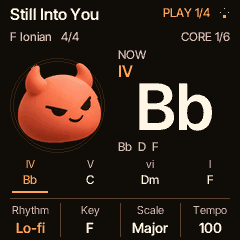
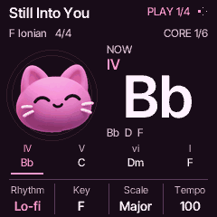

# CORD mascot development build

The native HOME now follows the approved Soft Mascot Studio direction: a shaded
floating head on the left, the actual chord on the right, the planned phrase
below, and four physical controls in a separate bottom strip. This development
build is separate from the published chase10 download. Hardware review is pending.




## Choose your character

Open **GLO → Display** and turn **K1 CHARACTER**:

- **Devil** selects the complete **Ember** palette.
- **Cat** selects the complete **Plum** palette.

The palette follows the character across HOME, menus and the CORD boot mark.
There is no separate theme or accent selector. **K4 MOTION On/Off**, **K2 HOME
VIEW**, and **K3 BOOT SND** retain their roles. Cactus is outside this build.
The approved warm CORD chime is unchanged.

With Motion On and audible activity, the head dips, lifts and settles with mild
squash/stretch. Slow drift follows the same music clock. The pulse behind it
expands on accepted beats; chord changes can produce a small grin and accent.
Fills give a wink/grin, a committed drum drop gives the relaxed expression, and
a real downbeat return produces one finite reaction. Hidden views and Motion Off
consume old return events without replaying them later. A stopped, quiet HOME
settles instead of running a decorative idle redraw loop.

Motion Off leaves the mascot at rest while musical values, the real playhead,
pending changes, recording and save status remain truthful.

## Two bottom strips

The phrase strip has small degrees above the chord names and a short active
underline. A **single full-width rule** separates it from the control strip.
The four control cells have **three thin vertical dividers**, 11px regular labels
and 14px semibold values where they fit. Tempo omits the redundant BPM suffix;
external-clock labels remain explicit. The compact bank indicator moved to the
header, so it does not take a third row from the controls.

Native type uses **four coverage levels**, rather than the former one-bit mask.
The 11/12/14/16/32/64px Inter Tight faces use precomputed palette coverage ramps;
there is no runtime scalable-font cache. Whole altered/slash chord spellings are
retained in their bounded nameplate. Actual TFT readability still needs review.

## Fills, drops and returns

HOME now cycles **Core → Sound → Texture → Groove → Perform → Keyboard**.
Keyboard retains its full physical key guide and four inactive knobs.
Choose a rhythm, press PLAY, and open **Perform 5/6**:

| Control | Action |
| --- | --- |
| K1 Fill | Queue a one-bar turnaround; original groove returns automatically |
| K2 Drop | Drop drums at the next bar; chords/bass and phrase continue |
| K3 Back | Restore the groove on the next downbeat |
| K4 Tempo | Existing tempo control; external MIDI clock retains ownership |

The header separates queued and committed states. Gestures are transient live
performance actions, not edits to saved patterns or manual takes. Recording and
clock-interruption protections are retained. [Full behavior](DRUM-PERFORMANCE.md).

The engine was integrated from a stable local `codex/drum-performance` snapshot
based on `4502c2f`; that original checkout was left untouched. The mascot consumes
the engine's real snapshot fields, never inferring a fill from output loudness.

## Saved data

Preference v5 keeps the existing 44-byte object, sectors, favorites and remembered
Click-level packing. It stores only the two character IDs and Motion. Older
v1–v4 records validate under their original schemas, preserve favorites, Motion
and Click, and default to Devil without an automatic write. The musical settings
record remains 188 bytes. Existing sounds, Songs and recordings keep their formats.

An older firmware can ignore a v5 appearance/favorites record; retain the normal
pre-upgrade backup if downgrading. Rendering never writes flash.

## Build and inspect

The normal build generates `cf_mascot_art.h` from the approved source PNGs.
Both mascots and four expressions use 48,237 bytes of const image data: a shared
60-colour palette per character plus indexed row spans. They require no decoder,
heap, image cache, extra full-screen buffer or POOL allocation.

Run the focused checks after header generation:

```sh
sh tools/test_mascots.sh
sh tools/test_stage.sh
sh tools/test_home_banks.sh
sh tools/test_perform.sh
sh tools/test_native_pages.sh
```

These cover artwork bounds, real rendering, preference migration, interrupted
motion, transport/recording ownership and identical physical/USB/MIDI output with
visuals On versus Off. The installer/backup and remaining musical regressions
also remain required. Linked resources and package hashes accompany the build.
Host captures and a device link are not physical listening, input-latency, TFT or
sustained USB workload measurements.

The `0.6-mascot` package, including main's progression LED guide, links at
**554,952 / 573,440 bytes XIP**, **88,728 / 98,304 bytes ordinary RAM**, and
**316,792 / 344,064 bytes POOL**.
[Measured resources and exact compile inputs](../benchmarks/resources/mascot-home/report.md).
The package SHA256 is
`4e487632ffcc0f4b7a771cb7e0536c662f7cf08abe90276b4ae39f33aadefecb`.

[Artwork and prompt provenance](../assets/mascots/README.md).
