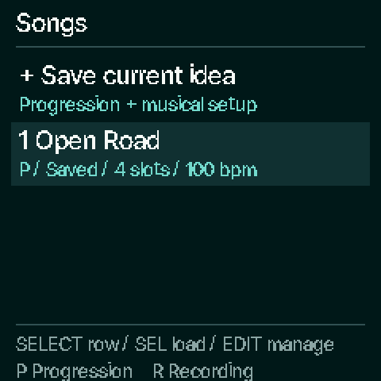
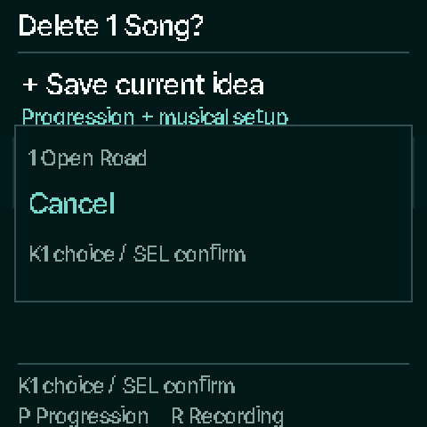

# Songs library — first native slice

Development implementation for [issue #46](https://github.com/chasedeanda/chaseflower-fm1/issues/46).
This is a firmware/emulator preview, with physical FM-1 checks still pending.
Initial source base: `abd37afab562555d4e8a58a66d18b488cce594f9`; integrated with
`09403c9` (native pages/motion) and `0d76e5b` (Chord Lab) before final verification. Design reference:
`845325136418dd038c7ef81eaca01ec64ac5e61e`.

## Use it

1. From Progressions, the accompaniment workspace or the semantic editor, press
   **SAVE** to open Songs. Playback keeps running.
2. **SELECT** highlights a row. Highlight **+ Save current idea** and press **SEL**
   to capture a new copy of the current progression and musical setup.
3. The new row says **Pending** until playback stops, keys/HOLD are released and
   voices/effect tails have settled. It says **Saved** only after the atomic write
   succeeds. Another save/recall waits while that protected transaction is pending.
   Pending is RAM protection while powered; it is not power-off persistence.
4. On a saved progression, **SEL** loads it when stopped and quiet. **PLAY** from
   HOME/editor uses the existing semantic accompaniment engine. An unsaved working
   draft blocks recall: return to that draft through HOME → EDIT and save it first.
5. **EDIT** opens management for the selected row. **K1** chooses Load, Duplicate,
   Rename or Delete; **SEL** executes. Rename uses **K1** for character position,
   **K2** for the printable character and **SEL** to save, up to 24 characters.
   Delete names one Song and defaults to **Cancel**. **EDIT** backs out; **HOME** exits.
6. Existing recordings appear with **R**; semantic progressions use **P**.
   **SEL** on a recording opens its existing fixed-note recording workspace.
   Recording management currently offers Load and Delete. Its pitches remain fixed.

Every Save current creates a separate copy in a free slot; it does not update the
highlighted row or replace an older idea automatically. Unknown/corrupt records
remain Unavailable and are excluded from automatic allocation. When all six slots
are occupied, manage/delete a saved idea. Sound-only SAVE remains available from
the sound/envelope pages. The catalogue's existing favorites workflow remains
available from its browser pages.

## What a saved idea contains

The existing sixteen-slot semantic phrase includes degree, source chord mask,
quality/color, durations, gate/tie, inversion/register and bass choices. The save
also captures key/mode/metre, stable source/groove IDs, tempo, kit/swing,
drums-only/repeat settings, chord/bass patches (including unsaved engine edits),
part levels/pan/mute/sends, Harmony, arp, glide and effects.

Recall restores musical settings while retaining the device's MIDI/USB/clock and
appearance configuration. Recalled patches are detached INIT edits so a changed or
deleted user preset cannot change the saved sound or become an accidental overwrite
target. The working draft and factory catalogue are separate from saved records.

This slice retains the current three-slot manual-recorder policy. It does not add
arranged direct capture, recording rename/duplicate, counted Clear Recordings/Clear
All, a dedicated Pending-capture discard action, or 128-bar/1024-event capacity.
There is no in-place Update flow or running complete-idea recall yet. Those remain
under #46; the canonical design contains their future workflow targets.

## Persistence and compatibility

Six appended storage objects occupy `0xF0000..0xFBFFF`: independent 8 KiB A/B pairs.
Existing objects, archived eight-pattern content, updater staging, user sounds,
three recordings and working-draft addresses retain their layouts and locations.
The loader's existing reserved region already extends to `0xFC000`; no loader or
boot-stub change is needed. Device flash-write range checks explicitly cover the
new pairs and reject cross-boundary or overflowing writes.

The checked `CSL1` v1 record is 1,388 bytes, including the existing 344-byte semantic
codec, setup and two independent patch snapshots. Size/version/inner semantic and
sound checks reject unsupported or corrupt records before applying anything.
Changes to these embedded layouts require a record-version/migration decision.
One frozen pending image lives in POOL; only six small summaries stay in ordinary
RAM. No library flash call runs in the audio callback. Writes wait for a quiet
foreground boundary; interrupted saves retain the previous committed copy.

Backup IDs **81–86** expose these records through the existing protocol. Both JS
and Python tools name/restore them, and older firmware skips unsupported IDs.
Backup/restore reports Busy while a new Song transaction is pending, preventing a
backup from silently omitting it. A restore validates first, requires quiet and
locks persistence until restart.

## Evidence

These are captures of the native firmware renderer, displayed at 2×. The scripted
interaction is [capture.txt](images/song-library/capture.txt). They are not photographs
or TFT readability/timing measurements. The screen caches its model and stays
settled when nothing changes, including with Motion Off.

Run `sh tools/test_library.sh`. Coverage includes complete recall and edited patch
retention, unsaved-draft/HOLD protection, a frozen pending image, retry status,
rename/duplicate/delete/full/unavailable states, corruption rejection, storage
address isolation, backup restore validation and existing recording routing.
The six-object storage simulation passed **6,230 power cuts**, **54,660 checks**,
and **1,500 operations** with no failures. Existing editor, HOME-bank, accompaniment,
progression, Auto Harmony, recording, USB, backup and installer checks also passed.
After merging the native-pages update, library/editor/recording/backup/accompaniment
and USB suites passed again, including 877 native routes and identical Motion
On/Off audio, six USB channels and MIDI at both sample rates.

The integration preserves the upstream native page/motion renderer and Chord Lab.
Songs uses CSL symbols to keep the Lab's existing CFL symbols independent. SAVE
from Chord Lab cancels its audition and opens Songs; pending audition requests
participate in the common quiet check. Existing semantic insertion and undo pass.

[Linked report](../benchmarks/resources/song-library/report.md) and
[dependency/build identity](../benchmarks/resources/song-library/identity.json)
record the working source and compiler options. Linked totals:

| Region | Used | Remaining |
| --- | ---: | ---: |
| Ordinary RAM | 87,864 B | 10,440 B |
| POOL | 316,792 B | 27,272 B |
| XIP | 459,852 B | 113,588 B |
| RAM code | 3,128 B | 21,448 B |

Against the integrated Chord Lab reference, this adds 800 B ordinary RAM, 1,388 B POOL,
7,212 B XIP and 36 B RAM code. The comparison reference is recorded in the report;
these linked headrooms do not measure runtime stack or audio timing. Physical
edit → save → power-cycle → recall, TFT legibility, live HOLD/tails and USB recording
under library use remain device-validation work. No hardware was flashed.
