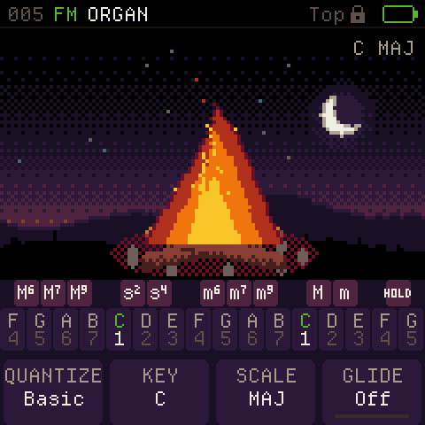
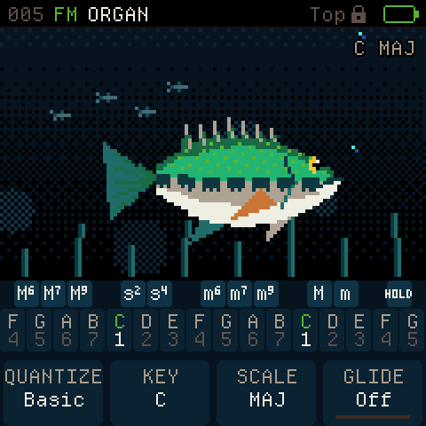
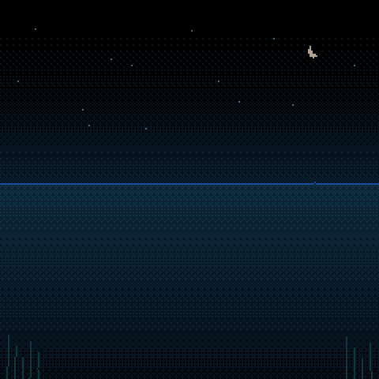

# Chase FM-1 scenes and boot

This feature replaces the flower/coral pictures with the approved bonfire and swimming bass, and adds the approved **Chase FM-1** bass-jump boot screen. It is prepared for merging independently of the other features. No release version, release package, published site or device flash is part of this merge request; the combined release build comes after the features reach main.

## Controls and saved settings

- The instrument always plays in **Top Lock**, including after loading an older record or restoring a backup. The Top chord-button definitions and other musical settings are preserved.
- Turn **ALGORITHM** on HOME to cycle **Bass → Bonfire → Scene Off** (reverse the encoder to go back). The selection appears immediately, including when starting from Chord or Keyboard view. A brief name message confirms the selection. It does not reconfigure the chord player, retrigger a held chord, or change transport.
- **Scene Off** uses a plain background throughout HOME and the menus. It bypasses scene/background rendering, the scene canvas blit, animation ticks, note-particle/geometry updates and the visual voice-level scan. Chord names, controls and beat indicators still work. The choice is saved with settings and survives switching HOME views. Use it to compare device performance with the animations disabled; host audio comparisons do not establish hardware timing or diagnose a glitch. The brief startup intro has its existing behavior.
- Tap HOME while already on HOME to cycle **Scene → Chord → Keyboard**. The scene and HOME view persist independently.
- ALGORITHM retains effect ordering in FX and pattern/song selection in Sequencer. Elsewhere, its former chord-mode action selects the scene.
- Bass is the default, including for older records without a scene flag. Bit 3 of `cf_set_t.seq_hint` selects Bonfire when set; bit 4 selects Scene Off and takes priority. Bits 0–2 remain sequencer hints, bit 5 remains free, and bits 6–7 remain the existing HOME view. The settings record remains 188 bytes and backup formats do not change.

## Approved visuals

Bonfire has a taller, triangular flame, curling golden ribbons and rising embers. Bass keeps its original colors and silhouette, with a gentle body wave, moving fins/tail, bubbles and four distant baitfish. Both scenes keep the approved backgrounds and animate quietly when idle. The existing Scene/Ripples/None backdrop setting still applies.

While transport or the metronome runs, each music-clock beat now gives the bass a clear forward/upward kick, tail flick, stronger body wave and extra bubbles. The background baitfish make a smaller dart. Bonfire flares taller and wider, brightens the light around the logs and adds sparks. These beat accents use the audio engine's timestamp through the existing UI snapshot, follow internal tempo or MIDI sync, and count eighths in 6/8. They decay within 280 ms (shorter at fast tempos) and stop with transport/metronome. Click volume and master volume do not affect them.

Played notes, sequencer chords and arp onsets still add their own accents: extra body/tail motion, a small forward nudge and bubbles for Bass, and flame height/sparks for Bonfire. Beat motion remains visible under a held or repeatedly triggered chord. Idle drift and flicker continue when the clock stops.

The 2.4-second boot animation shows a night lake, a swim-by, a jump with small splashes and the Chase FM-1 title. The entire fish, including its moving tail, clears the right edge before the animation ends. Any user input skips it. SAFE MODE retains its notice, and the existing optional boot chime remains available. The compatible INFO family, USB names, package identity, loader and boot stub stay unchanged.

The boot GIF holds the final frame for 850 ms for review; the firmware transitions to HOME after 2.4 seconds.

## Implementation and validation

`cf_scene.c` renders both scenes using integer primitives and a shared 80×48 sprite buffer in POOL (3,840 bytes). HOME and the boot animation share that sprite renderer. `cf_boot.c` uses Q8 positions and Q14 rotation directly into the existing framebuffer, without floating point, allocation, or another full-screen buffer. Key input is pumped during longer drawing loops.

Local verification on 2026-11-06:

- Actual JieLi firmware/package build passed, including protected-sector and memory-layout checks. The local package is a verification output, not a release candidate for installation.
- XIP: 393,880 / 573,440 bytes. General RAM: 94,940 / 98,304 bytes (unchanged). POOL: 333,596 / 344,064 bytes, leaving 10,468 bytes.
- Visuals tests: settings migration, saved scene/view/hint round trips, Top Lock enforcement, HOME/FX/Sequencer controls, backdrop/bounds checks, actual integer boot exit, input skip and SAFE MODE. 4,678,040 checks passed; AddressSanitizer passed too.
- Two fresh processes rendered the same held latched chord and playing rhythm with and without repeated scene changes. Every physical-output word and all six USB capture channels were identical (8,587 checks per render).
- Existing chase3 library/timing/saved-sound suite: 45,944,834 checks passed, plus 230,705 VA checks.
- Existing USB protocol/capture suite passed, including 56 USB-active/idle render comparisons at both rates and the Python tool tests. Backup, chord, theory, VA and storage-log checks also passed.
- Inspected actual firmware-rendered scene and boot frames. Hardware timing and appearance remain for the user's combined build and device check after merging.

Run from a generated checkout with `sh tools/test_visuals.sh`. The existing `check` workflow includes it. To render the firmware previews, create an output directory and run `build/host/cf_visuals_test --shots OUTDIR`; it writes PPM frames at native display resolution.

The beat-response checks cover muted-clock beats through the real engine/snapshot path, internal 4/4 and 6/8, MIDI sync, stop/restart, timestamp wrap, visible accents under a held note, background-school motion and rendering bounds. `build/host/cf_visuals_test --beat-shots OUTDIR` renders a separate 120 BPM demonstration, beginning and ending at idle, without note triggers or loudness input.

Scene Off checks cover settings round trips, encoder cycling in both directions, preservation of hints and HOME views, untouched animation state and scratch canvases while disabled, direct background clearing, and resuming with the currently held chord. Independent processes compare every physical-output word and all six USB capture channels with scenes enabled, disabled, and repeatedly switched during playback.
