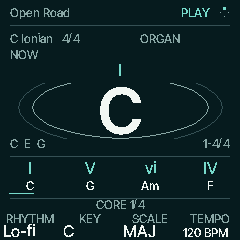
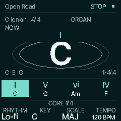

# HOME motion and live chord feedback

Follow-up to release 0.6-chase8, based on main
`28aeabb2fcf08e97bdd694f9411714f78a3a0ef6`. Measured firmware:
`ea0692c4d7619a9f84f691cf6469ed402a96453e`.



 

These are native 240 × 240 firmware frames from the host HAL, with the UI clock
deliberately offset from audio time. They are not hardware photographs.

The missing rings had a device-specific clock-origin bug: `cu.now` is system
uptime, while `cf_now_ms` restarts in `cf_out_init`. On a device the UI initializes
after audio and the startup wait; comparing those timestamps directly against a
150 ms freshness limit can reject every valid level. The emulator's aligned
clocks hid this. The new regression failed on both energy and halo before the fix.

Freshness now observes audio publication progress and expires a stopped publisher
using only UI elapsed time. A consumed peak window catches transients between
display frames, expires in 100 ms using the producer's clock, and is cleared by
mute/Motion Off. The snapshot copies bounded scalar state; rendering never reads
audio/voice buffers or changes gain, scheduling, input or persistence.

Two restrained rings pulse from accepted beat fraction and real output energy.
The top-right four-dot indicator follows that same beat fraction while a clock
is playing, including at zero output volume. Live sound/tails use level-driven
activity without a fabricated BPM. Wait, pause and clock loss stop the clock
indicator; stale output metadata decays to rest. Motion Off removes both effects
immediately and does not replay an old live-chord accent when turned back On.

Live progression matches use the existing `cf_progression_highlight` contract:
generic ideas match root/third quality; exact-source ideas require their full
intervals. Inversions do not matter. All visible repeated matches fill, including
under HOLD, and release clears them. Single notes/fallback do not count. The
actual sequence underline and editor focus remain independent. Matching is
essential feedback, so it remains visible with Motion Off.

Verification: 180 HOME assertions cover clock offsets, stalled/expired windows,
native header pixels, beat phase, actual Auto playing, repeated source matches,
HOLD/release and Off. Native-page comparisons preserve byte-identical physical
output, six USB channels and MIDI at both capture rates; HOME banks,
Accompaniment, Chord Lab and Songs/storage suites also pass. The actual JieLi
link/check passes; [exact linked evidence](../../../../benchmarks/resources/home-feedback/report.md)
adds 16 bytes ordinary RAM and 1,128 bytes XIP, with no POOL/RAM-code change.
These static values do not establish device timing or readability.

Reproduce after generating headers:

```sh
sh tools/test_stage.sh
mkdir -p build/home-feedback
build/host/cf_stage_test build/home-feedback
sh tools/test_native_pages.sh
```

Physical playback, TFT visibility and input/audio/USB timing still need review on
the device. For animation, use **GLO → Display → K4 Motion On**; at mute the rings
settle while a running clock can still move the status indicator.
