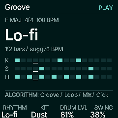
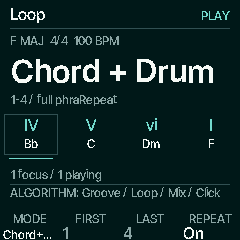
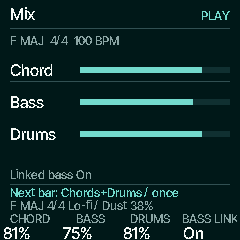
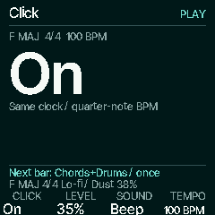
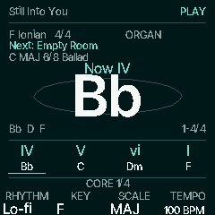
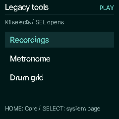

# Native accompaniment workspace

Source baseline: `e3333c1a41a5fd5b953f377552daff02a9701da9`, including the
expanded cover catalogue. Design: `845325136418dd038c7ef81eaca01ec64ac5e61e`.
The manifest pins implementation and source/image hashes.

These are actual 240 × 240 C renderer frames through the host HAL. Physical TFT,
listening, USB-device performance and encoder timing remain unverified.

 
 
 

## Navigation and real controls

SEQ opens Groove. ALGORITHM cycles Groove → Loop → Mix → Click; SEQ or HOME
returns to HOME/Core. Page changes neither start transport nor change parameters.
PLAY uses the existing single accompaniment clock from every tab.

| Tab | K1 | K2 | K3 | K4 | SELECT / SEL |
| --- | --- | --- | --- | --- | --- |
| Groove | Compatible rhythm | Kit | Drum level | Swing | Browse rhythm / restore its kit and swing |
| Loop | Chords+Drums or Drums only | First (read-only) | Last (read-only) | Repeat On/Off | Move explicit slot focus / no audition |
| Mix | Chord level | Bass level | Drum level | Linked bass On/Off | Move explicit mix focus / no action |
| Click | On/Off | Remembered level | Sound | Tempo | No action |

Loop uses the entire phrase in phase 1. Repeat Off ends after its final complete
slot; it does not kill independent live HOLD. A queued new idea wins at the old
phrase boundary and begins at slot 1. The focus box and actual playing underline
are separate. Mix bars show real settings, not invented loudness/VU readings.
Groove draws actual kick/snare/hat masks and accepted bar/step; no cursor runs
while stopped, waiting or paused. Unsupported metres retain honest Off/Click
choices without fabricating a pattern.

Pending name/setup lines show the queued key, mode, metre and rhythm separately
from the applied setup. Active bar edits also identify accompaniment mode,
repeat, kit and swing. A queued new idea stays separate from current-idea edits.
Finite page, chord and footer transitions use bounded latest-target offsets;
Motion Off cancels them and settled screens skip raster/hash/TFT work.

## Click and external clock

Click has its own real gain alongside any groove, driven by the same musical
clock. Enabling it never starts another transport. Off preserves the remembered
level; editing that level while Off leaves it muted. Selecting the Click rhythm
explicitly enables the remembered level, immediately when stopped or at the next
bar when running. A later explicit Off cancels pending automatic enable. A stale
queued tempo/metronome event cannot undo a newer bar-boundary Click enable.

PLAY in Receive mode arms the progression and waits without sounding a scheduled
chord. Clock pulses start it, and explicit MIDI Start/Continue also works. After
300 ms without pulses, scheduled chord/bass/drum ownership releases and transport
pauses; the true position and queued requests remain. Independent live HOLD is
preserved. Pulses alone do not restart lost transport: send Start (slot 1) or
Continue (retained phase). Switching a running internal clock to Receive pauses
and waits for explicit Start/Continue. Changing back after a loss keeps it paused
until an explicit PLAY restart.

## Retained data and tools

GLO → Legacy tools, K1 selects, SEL opens **Recordings / Metronome / Drum grid**.
The retained metronome still has its older SEQ destination carousel. Advanced
sound, effects, diagnostics, backups, update and recovery routes remain usable.
The current manual-take recorder and latest-three rotation/protection policy are
preserved; this slice does not implement semantic Songs or arranged capture.

Preferences now write version 4 in the existing 44-byte v3 layout, packing
remembered Click level into its two appearance bytes. Real 28-byte v1/v2 and
44-byte v3 records load without writing, preserving their favourites and
appearance; older records default remembered level to the current positive Click
gain or 35%. Backup validates both legacy lengths and the new version. Object,
sector allocation and the 188-byte global settings layout are unchanged. Older
firmware rejects v4 browser preferences and falls back to defaults; use a
pre-upgrade backup to restore its compatible favourites/appearance record.

## Evidence

- 730 focused workspace checks: all catalogue phrases end exactly once; queue,
  HOLD, external wait/loss/Start/Continue, navigation, Click gain/races,
  preference migration, finite transitions and settled native caches.
- 153 native HOME checks, existing HOME-bank and accompaniment suites, recording
  power-cut/backup ordering checks, 228 backup checks, progression/suggestion,
  USB (64 render comparisons), diagnostics and retained/scene-free regressions.
  Relevant host comparisons preserve physical-output samples, six USB channels
  and MIDI across both supported sample rates. These are host HAL comparisons.
- ARM-target syntax and the real JieLi app link/check pass. The exact paired
  [resource audit](../../../../benchmarks/resources/accompaniment-workspace/report.md)
  adds 752 bytes ordinary RAM and 9,344 bytes XIP; POOL and RAM code are unchanged.
  Remaining ordinary RAM is 17,480 bytes, POOL 28,660 bytes and XIP 100,072 bytes.
  Static capacity does not establish CPU/audio/input margins on hardware.

Reproduce after generating headers:

```sh
sh tools/test_accomp_workspace.sh
sh tools/emu/cf_headless.sh docs/design/chord-first/native-accompaniment/capture.txt build/native-accompaniment
```

A/B physical exit checks remain pending. Semantic editor/draft/Songs, arranged
recording, full adaptive audio-tail instrumentation, remaining native pages and
learning/suggestions remain subsequent milestones. The current manual recording
policy takes precedence until that source boundary is explicitly reconciled.
