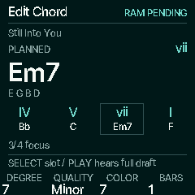
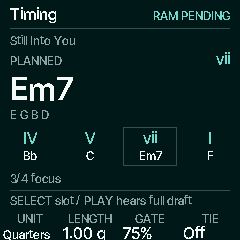
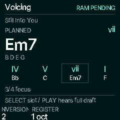
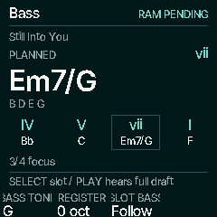
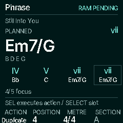
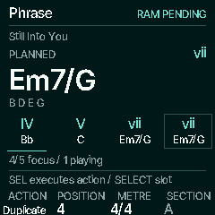
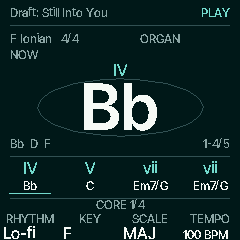
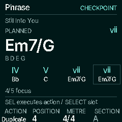

# Native semantic editor and protected checkpoint

This Milestone C slice builds on merged PR #64, source
`8aa00071222dbc1ee35bb0011e63ac0b2ce794d8`, and design
`845325136418dd038c7ef81eaca01ec64ac5e61e`. The manifest pins implementation and
capture hashes. These 240 × 240 frames come from the actual C firmware through
the host HAL; physical TFT, listening and input/USB margins remain pending.

 
 
 
 

## Develop a phrase

From Progressions HOME or Accompaniment, **EDIT** opens a protected copy of the
selected phrase. **SELECT** chooses a numbered slot; it never guesses from a
repeated chord. **ALGORITHM** chooses the five tabs. EDIT/HOME returns home;
SEQ opens Accompaniment. Navigation does not start or stop music. Advanced Sound
remains available through **ENV → EDIT** and from other sound contexts.

| Tab | K1 | K2 | K3 | K4 |
| --- | --- | --- | --- | --- |
| Edit Chord | Degree, retaining source root alteration | Follow/explicit quality | Deliberate color | Length in bars, when using bars |
| Timing | Bars/quarter-note unit | Length | Gate 20–100% | Tie |
| Voicing | Root/1/2/3/Smooth | Chord register −2…+2 octaves | — | — |
| Bass | Available chord tone | Bass register −2…+1 octaves | Follow/Off for this slot | — |
| Phrase | Insert/Duplicate/Remove/Undo | Numbered position | 2/4…7/4, including 6/8 | A, read-only |

PLAY hears the complete working draft through the existing accompaniment clock.
SEL executes the selected **Phrase** action. Insert creates a tonic one-bar
Follow chord before the target; Duplicate copies after it. Remove opens a named
confirmation defaulting to Cancel, refuses the last remaining slot, and remains
undoable. At sixteen slots an extra insert/duplicate is refused intact. Native
phrase Undo preserves the latest independent tempo/performance settings.

Factory and saved sources are never edited in place. Exact source intervals,
chromatic roots and slash bass survive copying. Planned slot/chord/notes and
focus are clearly labelled separately from the true player position. HOME says
**Draft:** and uses the accepted plan snapshot while playing; edits waiting for
an onset do not rewrite its active rail. Global live Harmony and independent
HOLD are preserved while the scheduled draft changes.

Edits to a running phrase publish a complete plan at the next chord onset.
Metre and new-idea setup still commit at the bar; groove/kit/swing remain
bar-bound even when a quarter-note slot ends mid-bar. The pending cue names both
boundaries when they differ. Bars follow the metre; quarter-note units retain
absolute quarter duration. Gate releases only scheduled chord/bass ownership.
Tie carries identical resolved chord/bass notes without retrigger; changed notes
articulate. The shared drum/click grid retains phase across short chord slots.
Global Bass Off still overrides per-slot Follow. External waiting/loss/resume
uses the merged accompaniment behavior, including a silent expired gate on resume.

## Keep a recoverable draft

A changed phrase stays **RAM PENDING** until transport, queued musical input,
physical keys, voices and audible effect tails are quiet. After the edit rests,
the main loop writes the verified checkpoint; only success shows **CHECKPOINT**.
A clean newly cloned phrase shows **FACTORY COPY**. SAVE from the editor or a
Draft HOME requests a checkpoint using the same safety checks; it reports
pending or write error honestly. It does not pretend to save a numbered Song.

The next boot offers the protected copy as **RECOVERED**, without automatically
playing it. EDIT on another factory source opens a conflict with **Return to
draft** as the default. The other explicit choice discards only the old draft
and begins a new copy. Browsing and returning HOME never replace a dirty draft.
A failed/unknown checkpoint is kept unavailable for backup/recovery and is not
automatically overwritten. Failed writes retain the current RAM content.

The checked 344-byte CSG1 v1 codec lives in its own **EE000/EF000** A/B pair with
512-byte log entries. It uses the established verified append/delta/A/B storage
protocol. Existing object enum values, sectors, recording policy and global
settings wire layout retain their meaning. Recovery also checks available
rhythm IDs, compatible metre and kit bounds before use. Backup object **75**
exports/restores the draft; web/Python installers name it. Restore validates the
complete codec and device bank metadata and waits for audio quiet. Restoring
other objects first does not block this record via the autosave restore lock.
Older firmware skips the new object; retain a backup for later recovery.

## Evidence and remaining scope

- **3,132 native-editor checks**: explicit focus and controls, unchanged originals,
  conflict/confirmation/undo, gates/ties, independent HOLD, same-clock queues,
  all 128 quarter durations in all six metres, sixteen-slot completion, all
  sixteen membership bits, final rail window and settled Motion Off caches.
- **10,690 storage assertions across 2,059 power cuts**, including 201 further
  interruptions at reboot; the draft and a neighbouring legacy object remain
  atomic. The semantic core's 62,449 checks and corruption tests also pass.
- Existing native HOME/workspace, accompaniment, HOME banks, recording power-cut,
  USB (64 render comparisons), diagnostics, installer, progression/variation and
  retained/scene-free suites pass. Backup now has **235 passing checks**.
- ARM syntax and real JieLi app link/check pass. The paired
  [device resource report](../../../../benchmarks/resources/native-editor/report.md)
  identifies exact committed inputs and measures static capacity, not CPU/audio
  or input latency. Compared with merged #64 this adds **2,224 bytes ordinary
  RAM, 15,304 bytes XIP and 40 bytes RAM code**. Headroom is 15,256 bytes ordinary
  RAM, 28,660 bytes POOL and 84,736 bytes XIP. The accompaniment plan is 348 bytes; runtime plus its two
  bounded mailboxes is 1,088 bytes. POOL allocation is unchanged.

Reproduce after header generation:

```sh
sh tools/test_editor.sh
sh tools/emu/cf_headless.sh docs/design/chord-first/native-editor/capture.txt build/native-editor
```

This is a usable edit/PLAY/recover slice, not the complete Milestone C exit.
Numbered semantic Songs, rename/duplicate/delete/clear collection workflows,
Save-then-edit-new conflict action, one-slot audition, the chord-library picker
and B/arrangement remain pending. Current **manual takes/latest-three rotation**
remain intact; arranged performance recording still requires its own explicit
integration. SAVE on a factory catalogue entry retains its favourites gesture;
existing sound SAVE workflows remain available elsewhere. Physical verification
and remaining motion/page migration are still pending.
