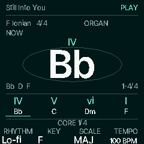
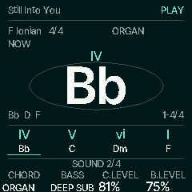
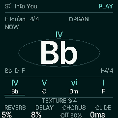
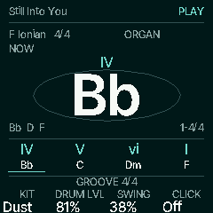

# Native HOME banks preview

Follow-up to merged [PR #57](https://github.com/chasedeanda/chaseflower-fm1/pull/57),
reconciled with source `4e678049762279740f750ec3566ed1e0939c26a1`, including #58's
source-cover-chord behavior. Design revision:
`845325136418dd038c7ef81eaca01ec64ac5e61e`.

These are native 240 × 240 C firmware frames through the host HAL. They are not
physical TFT captures, listening results or measured hardware timing.

 
 

## Controls

While on Progressions, tap HOME to cycle **Core → Sound → Texture → Groove**.
HOME from another screen, legacy view or secondary scene returns to Progressions
Core. Switching banks changes no musical value, source, preset, held note, cursor,
queue or transport state. The chord/header and phrase remain anchored. The new
labels take effect immediately; only the bank name settles horizontally, clipped
inside its footer region, for up to 160 ms when Motion is On. Off cancels this
visual work immediately and does not replay it when switched On.

| Bank | K1 | K2 | K3 | K4 |
| --- | --- | --- | --- | --- |
| Core | Compatible rhythm | Key | Scale | Tempo |
| Sound | Chord sound | Bass sound | Chord level (`C.LEVEL`) | Bass level (`B.LEVEL`) |
| Texture | Reverb mix | Delay mix | Chorus mix | Chord sound's glide |
| Groove | Kit | Drum level | Swing | Click level / Off |

SELECT browses the full progression catalogue from every Stage bank. PRESETS
keeps its global chord-sound role. MASTER and OCT−/OCT+ retain their musical roles.
Sound pickers reuse existing bank filtering and linked envelope behavior.

Texture edits retained mix parameters. Its readout explicitly says **Off** for a
disabled effect or **Byp** for a bypassed chain, without silently enabling either.
Use FX to enable the effect or leave bypass. Click adjusts the real 0–100 level;
it sounds with the existing musical clock and never starts a separate clock.

Kit/swing edit the selected compatible premade rhythm. During accompaniment they
use its existing **bar-boundary queue**. Readouts stay on applied values until the
bar commits; the Next setup cue identifies a pending edit. A queued new idea is
kept separate from edits to the active idea. Off/Click without a drum rhythm
leaves Kit/Swing disabled with **No rhythm**; they also remain protected during a
recording, as on the existing drum page. Drum level and Click retain their own
supported controls. No synthesis engines or fake macros were added.

GLO → Display → **K2 HOME VIEW** selects Stage, Chord, Keyboard or Diagnostics.
Tap GLO again to see that view. HOME returns to Core. Existing saved view/hint
bits remain valid. Bank selection is session-only and creates no preference save.
The existing Diagnostics detail page remains reachable in GLO as well.

HOME transport labels now distinguish progression PLAY/PAUSE, recorded REPLAY,
DRUMS, CLOCK, count-in and REC. The planned rail uses the source-chord APIs from
#58 so extensions, alterations and slash bass notes are preserved. Its true player
cursor stays independent of repeated chords, live takeover or bank focus.

## Verification

- 194 bank/source-rail assertions: mappings and bounds, unchanged HOLD and header/
  chord pixels while switching, no queued event/flash/music changes from cycling,
  source intervals/slash bass, retained views, FX bypass, Click clock behavior,
  queued Kit/Swing commit, and interrupted On/Off bank transitions.
- Byte-identical host audio with Motion On while cycling/drawing banks versus a
  steady HOME frame. Existing accompaniment and progression suites also pass,
  including physical-output comparisons with USB/drawing at both supported rates.
- Affected Chase3, Diagnostics, retained scene/view and scene-free checks pass.
  The scene-free/retained builds preserve identical physical audio, all six USB
  channels and MIDI at 44.1 and 48 kHz.
- ARM syntax and the real JieLi app link/check pass. The
  [resource report](../../../../benchmarks/resources/home-banks/report.md) includes
  exact source/dependency hashes, flags, macros, ELF identity and the paired main
  baseline. This slice adds **16 bytes ordinary RAM and 2,320 bytes XIP**; POOL
  and RAM code are unchanged. Ordinary RAM headroom is 18,376 bytes and POOL
  headroom is 28,660 bytes. These static numbers imply no CPU/polyphony/timing improvement.

Reproduce the native captures after header generation:

```sh
sh tools/emu/cf_headless.sh docs/design/chord-first/native-home-banks/capture.txt build/home-bank-captures
sh tools/test_home_banks.sh
```

Physical TFT legibility, native footer density, rapid playing/encoders, stop/panic,
external clock loss/resume, heavy FX/USB workloads and storage/power-cycle checks
remain pending. Full Groove/Loop/Mix/Click page migration, detailed queued setup,
other finite transitions, audio-tail instrumentation and complete Songs workflows
remain subsequent work. Do not mark Milestones A or B device-verified.
