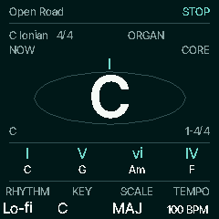
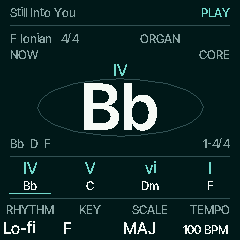
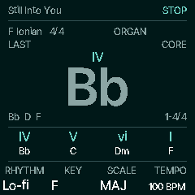

# Native Instrument Teal HOME preview

This is the first implementation slice of Milestone A, based on merged source
`8bc9086cceb98544713bab1907543d632c703981` and design publication
`845325136418dd038c7ef81eaca01ec64ac5e61e`. Milestone A's physical exit is **pending**.

The captures below are 240 × 240 frames from the real C firmware renderer under
the host HAL. They are **not physical TFT captures**, listening tests, measured
hardware timing or proof of a released interface.

 


Reproduce after `python3 tools/build.py --gen-only`:

```sh
sh tools/emu/cf_headless.sh docs/design/chord-first/native-home/capture.txt build/instrument-teal
```

The script captures Ready, live input, Last after release, progression playback
and Motion Off. `ready.png` and `last.png` retain the other two native frames.

## Implemented preview

- Native Inter Tight bitmap faces at 12, 16, 32 and 64 px; bounded ASCII glyphs,
  conventional `b`/`#` accidentals, clipping and composed long chord identities.
  Fonts use the repository's SIL OFL asset. No runtime font cache or new POOL buffer.
- Instrument Teal by default, plus the supplied Studio and Editorial tokens.
  GLO → Display exposes **K1 Theme / K4 Motion On or Off**. The existing boot-sound
  control remains K3. Legacy musical settings remain 188 bytes.
- Now/Last chord and actual accepted note list, actual degree, planned degree above
  chord name, four-slot windows with a position range, real player cursor, queued
  idea/setup label and the existing recording count-in/capture plaque.
- Four Core controls retain their existing musical mappings. Global PRESETS and
  live/HOLD/release/playback ownership are reused. No new playback clock or engine.
- One complete fixed-size display model is compared before HOME rasterization,
  tile hashing or LCD transfer. Settled Off draws nothing until visible data changes.
  Foreground glyph strips and existing tile transfers service note input.
- On uses a bounded attack/release envelope from master volume and existing
  note/bass/drum-hit metadata, with emphasis from the shared beat timestamp.
  This is a documented fallback, **not a measured post-gain audio envelope**.
- Off settles legacy decorative phase/scroll/knob/battery effects while real
  musical, recording and destructive-confirmation countdown data still updates.

## Persistence and compatibility

Preference record v2 gives the former two reserved bytes a palette and motion
meaning. Record size, object number and flash sectors are unchanged. v1 restores
favorites/order and defaults to Instrument Teal/On without an immediate write.
Legacy accent and all other old settings bytes remain intact. Valid v2 choices
survive restart and the existing backup/restore path; invalid choices are rejected.
Explicit appearance edits use the existing delayed append/quiet-erase policy.
Drawing never writes flash. Factory reset clears this existing preference object.
Older firmware only understands v1 and can ignore v2 favorites/appearance after a
downgrade; recordings and legacy musical settings retain their own formats.

## Evidence and remaining work

Focused checks: 51 HOME/appearance assertions, 188 backup assertions, 101 recording
assertions, 45,334 recording power-cut assertions, flash-range and reordered web/
Python recording restore checks. Existing accompaniment checks pass, including
144,193 assertions and byte-identical physical output with USB capture/drawing
at both 44.1 and 48 kHz. ARM syntax and the JieLi app link/check pass. Full regression
coverage is delegated to the existing PR CI workflow, including the new HOME check.

See the [linked resource report](../../../../benchmarks/resources/instrument-teal-home/report.md)
and its dependency hashes, compiler flags, macros, ELF identity and build log.
Against the exact merged source base, this slice adds 592 bytes of ordinary RAM
and 35,600 bytes of XIP. POOL and RAM-resident code are unchanged. Ordinary RAM
headroom is 18,392 bytes; POOL headroom is 28,660 bytes. Static memory use does
not establish runtime/display/audio performance.

The first slice preserves the existing HOME Chord/Keyboard/Diagnostics gesture;
the planned Core/Sound/Texture/Groove bank cycle is still Milestone B work. Popups
and advanced routes retain their working legacy layouts. Finite chord/page/list
transitions, custom accent, detailed queued setup, full Songs/recording lifecycle,
post-gain/tail activity metadata and device tuning remain pending. Legacy pages
settle in Off but still use their existing draw/hash path; HOME has the new
semantic invalidation path. Do not mark these wider contracts complete.

Physical gates remain: native TFT readability/contrast, long symbols, rapid input,
HOLD and note release while drawing, stop/panic, external-clock loss/resume, the
heavy chord+bass+drums+FX/USB workload, and real storage/power-cycle behavior.
