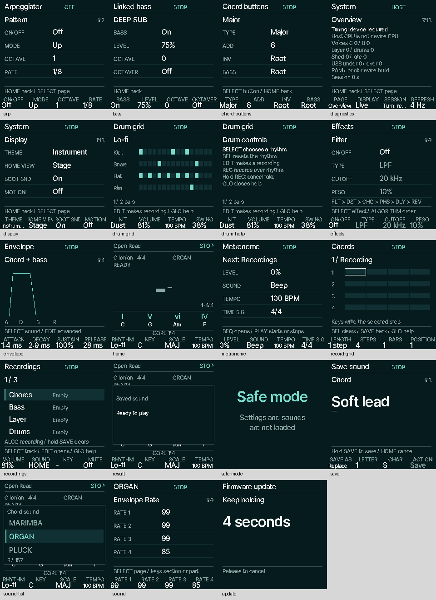

# Native retained screens and motion

The user's current priority is to replace every retained old screen and complete
its motion before adding more musical workflows. Chord audition/library remains
deferred. This slice builds on main `abd37afab562555d4e8a58a66d18b488cce594f9`;
the measured firmware source is `ba15c3342d121f44c314935c66fc7d60876ba1ce`.
The selected design remains `845325136418dd038c7ef81eaca01ec64ac5e61e`.

These are actual host-HAL framebuffer captures, rendered by the firmware at
240 × 240 with the native fonts. They are not browser mockups or hardware photos.
Run `sh tools/test_native_pages.sh` to regenerate the source PPMs in
`build/native-pages`.

## Coverage

| Existing surface | Native replacement |
| --- | --- |
| HOME chord / keyboard / diagnostics alternatives | Large chord and live key map; native engineering readouts |
| Chord buttons, linked bass, arpeggiator | Shared parameter pages with unchanged controls |
| Envelope | Real ADSR shape, linked target and four labelled controls |
| Advanced FM6 / VA, including retained Layer | Every existing section/page/part through the native parameter family |
| Effects and FX presets/manage | Native parameters, preset status, naming/hold and error/result popup |
| Sound picker / save / replace / delete | Three-row sound window, native name cursor, actual save hold and result |
| All 13 existing System pages | Native parameters, catalogue detail, diagnostics and tools |
| Existing latest-three recordings / tracks | Selected recording and exact four-track list; selected four-bar grid window |
| Drum grid and metronome | Actual percussion masks and accepted cursor; native help and controls |
| Reset | Original arm / three-second hold / final six-second question, with explicit scope and cancellation |
| Popups, backup/restore notices, calibration notice | Shared native message/result family, wrapped text |
| Safe mode, update countdown, updater handoff, fatal fault | Native text; fault/update use a direct LCD path independent of UI state/input |
| Optional scene-profile startup | Existing animation retained, caption uses native typography |

The old frame dispatcher is no longer called. The linker removes unreachable
legacy rendering; retained controller/data compatibility is preserved. There is
one framebuffer and no replacement sound, recording, clock or persistence engine.
Advanced controls use generous parameter rows instead of the old decorative
plant/graph backgrounds. The retained manual-take/latest-three policy is intact.

## Motion and ownership

- Chord glyphs: immediate identity replacement, 120 ms / 5 px clipped settling.
- Accepted progression position: immediate destination; 120 ms underline growth,
  without sweeping through intermediate chord slots.
- Knob value: immediate number, 90 ms emphasis on its own footer column.
- Bank label: 160 ms / 10 px, clipped within its fixed footer band.
- Workspace: 170 ms / 8 px; the incoming body settles while header and controls stay fixed.
- List focus: immediate selected row, 100 ms restrained emphasis.
- Confirmed `Saved` message: 240 ms nonblocking acknowledgement. Pending/error
  messages never receive this success treatment.
- Recording/count-in and playheads use the existing transport snapshot. Hold-to-clear
  shows the real three-second countdown and progress, independent of Motion.
- Motion Off cancels offsets/envelopes/emphasis immediately. On resumes at current
  state; it does not replay hidden transitions. Settled models skip raster,
  hashing and LCD transmission entirely.

The audio owner publishes a scalar stereo block peak during the existing output
conversion loop, after MASTER (and USB Fixed's DAC gain). It is Q15, just before
Clean's sub-sample fractional bits. The UI never reads sample/voice buffers.
Motion Off skips sample analysis. Semantic Chord/Bass/Layer/Drums activity is
published once per part, with a 150 ms display decrement hold; FX tails contribute
real output level without becoming extra parts. The display uses a bounded
60 ms attack / 450 ms release, quiet hysteresis and a resting snap. Beat accents
use accepted clock state and stop on wait/loss/pause. There is no decorative BPM
clock, new intensity setting, FFT or additional framebuffer.

The proposed new saved-row arrival applies when an already visible named
collection gains a row. The current retained recorder does not provide the new
Songs collection; that transition remains with the future Songs work. This slice
does not manufacture Songs, Learn, Next, chord library/audition, arranged recording
or new musical engines.

## Validation and limits

- Native suite: **1,823 checks, 871 settled page/state routes**, including all three
  themes, existing screens, advanced FM6/VA sections, popups, reset questions,
  interrupted motion, Off→On and output meter agreement.
- Motion On/Off produce byte-identical physical output, all six USB channels and
  MIDI at **44.1 and 48 kHz** through the shared playback/queued-change fixture.
- Existing native HOME, banks, accompaniment, editor, checkpoint power-cut and
  scene-profile regression suites pass. CI runs the complete repository suite.
- Actual JieLi size/link/check passes; exact dependency hashes, flags, ELF identity
  and comparison are in [the resource report](../../../../benchmarks/resources/native-pages/report.md).

| Linked region | Bytes | Headroom | Change from native editor |
| --- | ---: | ---: | ---: |
| Ordinary RAM | 83,880 | 14,424 | +816 |
| POOL | 315,404 | 28,660 | 0 |
| XIP | 442,320 | 131,120 | −47,040 |
| RAM code | 3,092 | 21,484 | 0 |

Physical readability, actual LCD/CPU timing, input latency under the heaviest
patches, and on-device tail/motion tuning remain pending. Host byte equality and
linked headroom are not physical timing measurements. Recovery handoff is linked
and retains its existing audio-stop / USB-detach / intentional-boot sequence;
it has not been exercised on a connected device here.
