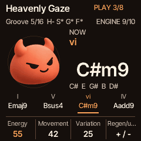

# CORD Engine Build 01

Implemented on merged Signature 8 (`1eef7c7`, PR #100). Only Heavenly Gaze (authored scene ID 2, progression source 253) is exposed. The supplied [rulebook](RULEBOOK.md), [handoff](HANDOFF.md), and [scene JSON](../../assets/engine/scenes-v1.json) are retained unchanged.

## Use

Cycle HOME to **ENGINE**, press **SEL** to load Heavenly Gaze while stopped, then **PLAY**. Eight two-bar chord slots loop continuously through Intro → Groove → Lift → Return. Core, Perform, sound browsing, live chord/HOLD takeover and the final Keyboard page remain available.

- K1 Energy: 0–100; independent 50 ms stage-gain ramp, orchestration gates at the next bar.
- K2 Movement: held below 65; at 65+ the existing scheduled chord arpeggiator runs only in bars 9–12, eighth notes, one octave, gate 70%, no latch. Changes enter at a chord boundary. Its existing pattern mode is preserved; the supplied specification does not select another mode.
- K3 Variation: no automatic harmony changes. From cycle 1, eligible bar-12 fills at 50+ / Energy 50+, plus bar-8 fills at 75+ / Energy 70+. Manual pending actions, active fills and latched Drop take priority.
- K4 clockwise: next curated combination; counterclockwise: one Undo. Sound, Groove and FX commit at the next bar, Harmony at the next two-bar onset. Latest queued request wins; no transport restart.
- GLO → Engine Locks: Harmony / Sound / Groove / FX, either direction toggles once per detent. Direct category edits engage their lock. All locked does not advance generation.
- SAVE uses the existing Songs workflow to save a **static eight-slot, 16-bar snapshot**, preserving exact authored pitches through the existing wire format. It does not overwrite the protected editor draft. Explicit EDIT can clone the snapshot into the editor under its existing draft protections.

## Implementation

`gen_engine_scene.py` emits only pilot note arrays, approved candidate lists, defaults and the five stage profiles. Sounds resolve by unique exact factory name; grooves resolve by stable ID, with an explicit DreamPop/Air-kit assertion. No factory programs, indices, synthesis engines or effect algorithms change.

A bounded bar controller reuses the accompaniment's 96-PPQN clock, eight 768-tick slots, note ownership, performance actions and existing staged sound/FX loaders. Energy scales output after the user's mix setting without modifying it. The audio path has fixed-size state, no new allocations, flash writes, harmony calculations or candidate searches. Sound/plan preparation and edit detection run in the foreground. The pre-existing empty-label footer read was bounded after the all-screen test exposed it.

## Validation

Run `sh tools/test_engine.sh` after normal header generation. It is included in CI.

- 850 Engine checks pass: exact pitches and ties, 64-bar phase/loop behavior, stage gains, snapshot encode/decode and note reconstruction, latest queued regeneration, Undo, locks, Core transposition/modal triads/tempo, scoped arp ownership, manual takeover/release, MIDI stop/continue/start and clean release.
- AddressSanitizer + UndefinedBehaviorSanitizer: 850 checks, no diagnostics.
- Both baseline and interactive four-cycle traces are byte-identical across fresh processes. Exactly 24,576 shared-clock ticks per four cycles; real rendering reaches bar 65 within one control block of 147.692308 seconds at 104 BPM.
- Actual DSP renders: peak 6,497 Q15, zero clipped samples; baseline RMS 1,389.166, interactive RMS 1,513.342; maximum 11/12 active ordinary voices respectively. Stop plus release-tail wait leaves no held chord/bass voices.
- Engine physical output is byte-identical with USB capture idle versus active at both 44.1 and 48 kHz across the full interactive four-cycle render.
- Passing existing suites: accompaniment, accompaniment workspace, ARP, Auto Harmony, Signature 8 (including legacy factory fingerprint), semantic Songs, Songs library/storage, editor/power cuts, keyboard, Perform, Variations, HOME banks, native pages/motion, stage, USB protocol/render comparisons, recordings/backup, progression browsing, drum bank, diagnostics, complete installer, ARM syntax and resource-audit parser.

Logs are under [logs](logs); [resource totals](resources.json) contain the actual device link result. Device checks pass for image regions, RAM code and HAL-only register access. No hardware timing claim is made.

## Four-cycle traces

- [Baseline exact-clock trace](baseline-64.csv) and [interactive exact-clock trace](performance-64.csv).
- [Baseline real-render/MIDI trace](midi-baseline-64.csv) and [interactive real-render/MIDI trace](midi-performance-64.csv).

Cycles are zero-based; displayed bars and slots are one-based. Gains are targets in Q15 (32768 = unity relative to the user's mix); output ramps to them over 50 ms. `planned_notes` describes the chord at bar entry. `emitted_chord_notes` is the unique set of actual MIDI chord note-ons during that whole bar; intermediate held bars have no note-ons, while arp bars have the emitted chord tones. Locks/pending bits: Harmony=1, Sound=2, Groove=4, FX=8. The real-render trace also records all three knob values, generation and committed candidate indices. Rows capture controls at bar entry; the scripted action below happens immediately after that row.

Interactive actions, absolute bars 1–64: Energy +20 at 6; Movement +35 at 10; Variation +80 at 12; Drop at 17; Regenerate at 19; Undo at 23; Sound lock at 29; Regenerate at 30; Undo at 32; Back at 35; manual Fill at 41; Core Key +1 at 45. This demonstrates different commit boundaries, Drop across the loop boundary, return via Back, automatic and manual fills, retained Sound lock, key transposition and continuous looping.

## Resources and limits

Relative to merged Signature 8 with the same device flags: XIP +5,940 bytes; ordinary static RAM +416 bytes; synthesis pool and RAM code unchanged. Final dev build: XIP 552,772/573,440; static RAM 90,624/98,304; pool 316,792/344,064; RAM code 3,128/24,576 bytes. Loader's padded RAM accounting is 90,636 bytes. No new persistent audio buffers or runtime heap allocation are introduced. Foreground temporaries reuse bounded plan/blob/loader structures; hardware stack high-water and callback worst-case CPU remain unmeasured.

Host CPU for 147.693 seconds of audio: approximately 0.85 seconds baseline and 0.91 seconds interactive in the recorded optimized run; sanitizers take about 2.9/3.5 seconds. These are process CPU observations on the development host, including polling/trace work; they are not device utilization or hardware deadlines. USB-active host runs remain below 1.3 seconds. Hardware CPU, ISR pressure, voice shedding and RAM high-water must be measured on the FM-1.

The existing drum API has no safe per-lane hat overlay. The specified quiet bar-7/bar-11 hat decorations are disabled, as explicitly permitted by the pilot handoff; no substitute groove was invented. Only the authored fills run. Rulebook §8 explicitly restricts Build 01 SEL reload to stopped transport because there is only one playable scene; no unfinished scenes or scene-switch menu is exposed. Cross-scene bar-1 switching belongs to a later multi-scene build.

Saved snapshots do not persist Engine dials, locks, generation, stage automation or regeneration history. The existing format remains unchanged. This build adds no independent melodic layer, new DSP, release publication or hardware flashing.

## Local dev package

The requested local development version is **1.0.3-dev.engine01**. `build/engine-dev/` contains the installable `.fwsc`, separate app binary, checksums and licenses. Only the `.fwsc` is an installer package. No GitHub release/tag was created and no device was flashed.
