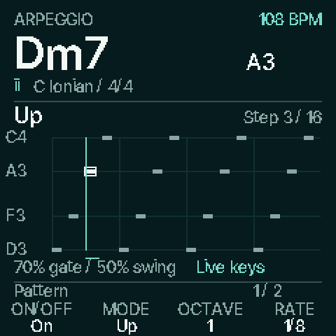

# Native ARP roll

Actual 240 × 240 firmware renderer captures, enlarged to 480 × 480 in the
three-second animation. The current Ember palette follows Devil; Cat uses Plum.
These are host-emulator renders, not photographs or browser mockups.

[Controls and pattern examples](../../docs/ARP.md).
Generate with `sh tools/test_arp.sh`, then `python3 tools/render_arp.py` (Pillow).

The local branch `codex/arp-piano-roll` integrates current main `ca52779`
(Keyboard Learn, mascots, FX readout), plus the visual ARP and four appended modes.
Source/build commit: `e30e296c9348c39185e0fb4799f201cac2020a87`.

The installable development package is `build/coralflower-0.6-arp1.fwsc`.
SHA256: `af61bdf06e6da6ebe021a6148f4589f30add4cc723f9f3973785f6c9af9d1de9`. Identity remains `FM-1_930`.
It has not been published as a firmware release or flashed by this task.

## Linked device resources

| Region | Current | Capacity | Added versus current main |
| --- | ---: | ---: | ---: |
| ordinary_ram | 90,096 | 98,304 | +600 |
| pool | 316,792 | 344,064 | +0 |
| xip | 570,208 | 573,440 | +6,424 |
| ram_code | 3,128 | 24,576 | +0 |
| noinit | 216 | 15,664 | +0 |

XIP headroom is **3,232 bytes**. The linked
image fits, but further features must recheck this small flash margin. POOL and
RAM code are unchanged. See [exact inputs, ELF symbols and paired report](../../benchmarks/resources/arp-roll/report.md).
The builder's runtime-clear-range RAM check also includes alignment padding;
the table reports actual ELF `.data + .bss` allocation sizes.

## Verified and pending

All thirteen modes, stable saved IDs and 188-byte settings, random event history,
both banks, octave/strum clipping, Motion Off settling, latch/release, live
takeover (including ARP disabled during takeover), progression return, external
clock stop/continue/loss and panic pass host checks. Physical audio, six USB
channels and MIDI compare byte-for-byte with drawing versus idle at both capture
rates, for live and progression playback. The adjacent native-screen, Auto/HOLD,
accompaniment, Chord Lab, recording/backup, Keyboard Learn, FX and mascot checks
pass. Node 24.18.1 runs the recording backup tests; the system Node 10 is too old.

Physical FM-1 appearance, listening, input/display cadence and sustained combined
audio/USB timing remain pending. Linked capacity is not a CPU-speed measurement.
